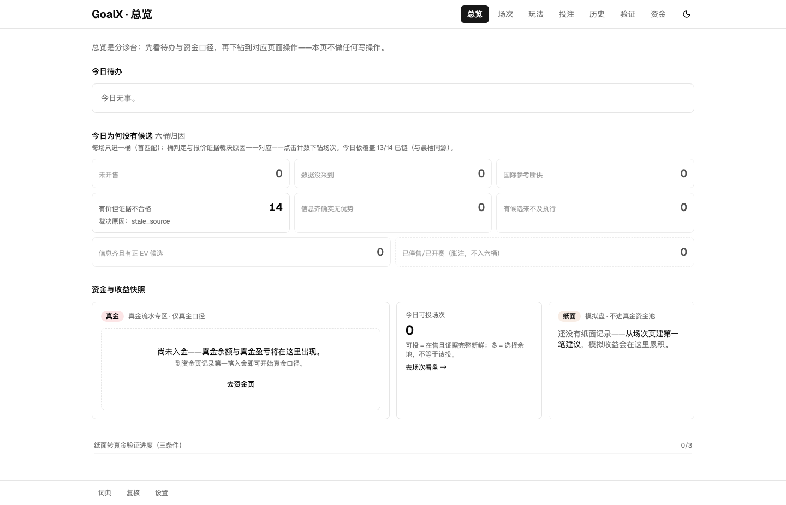
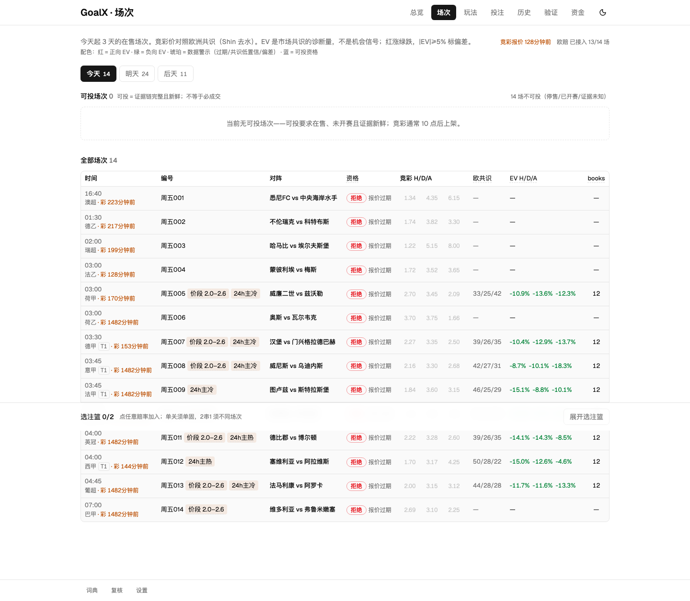
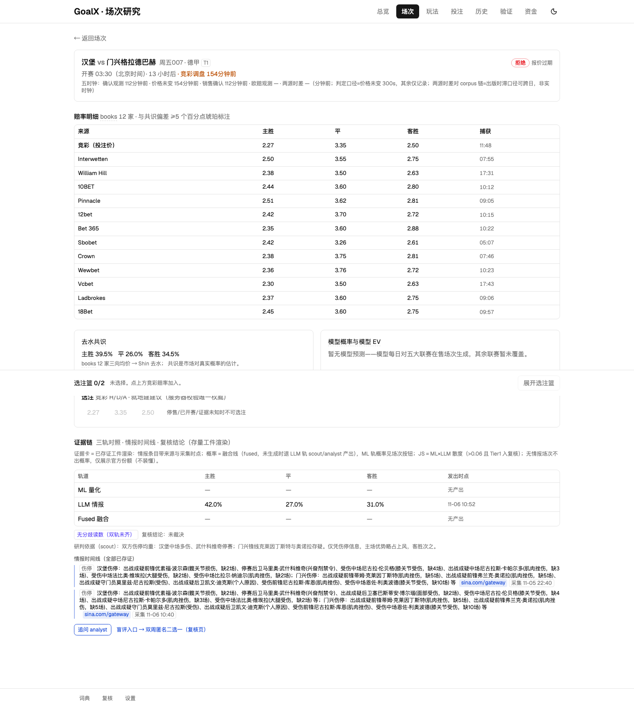
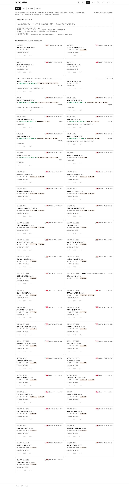
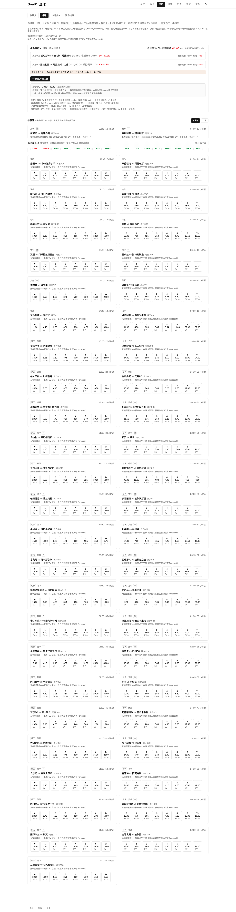
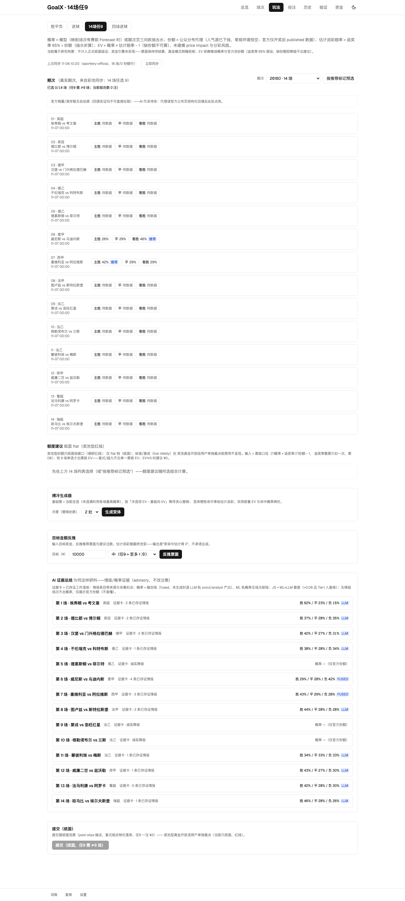
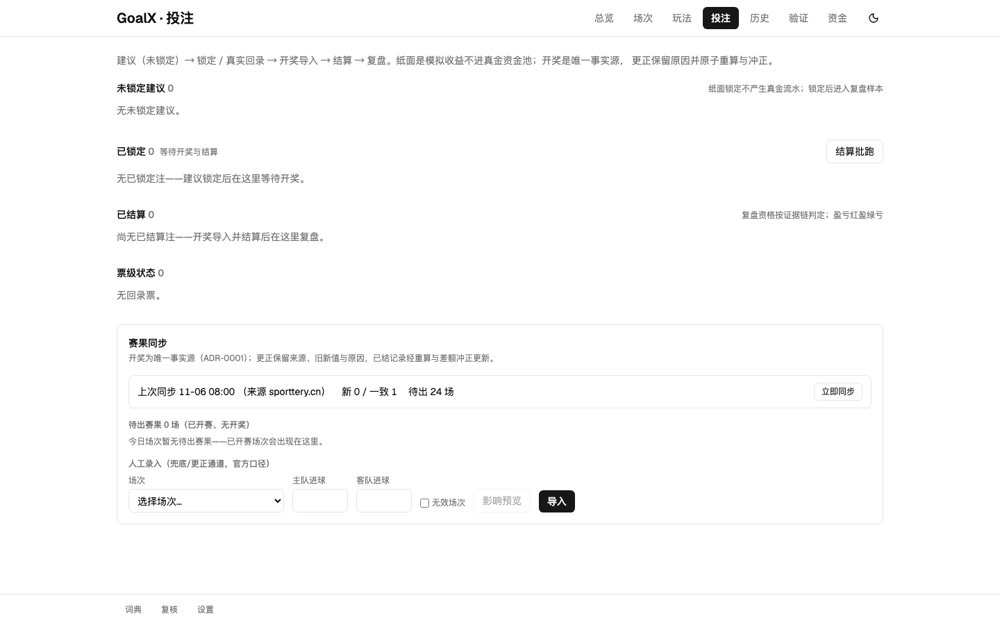
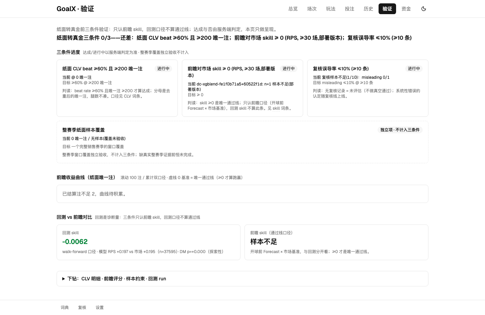
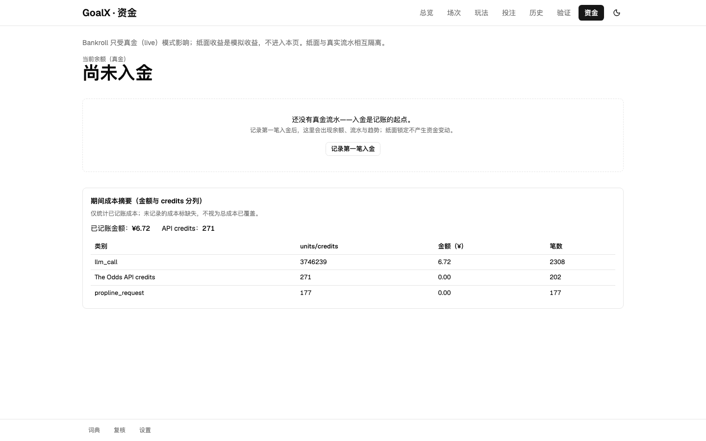
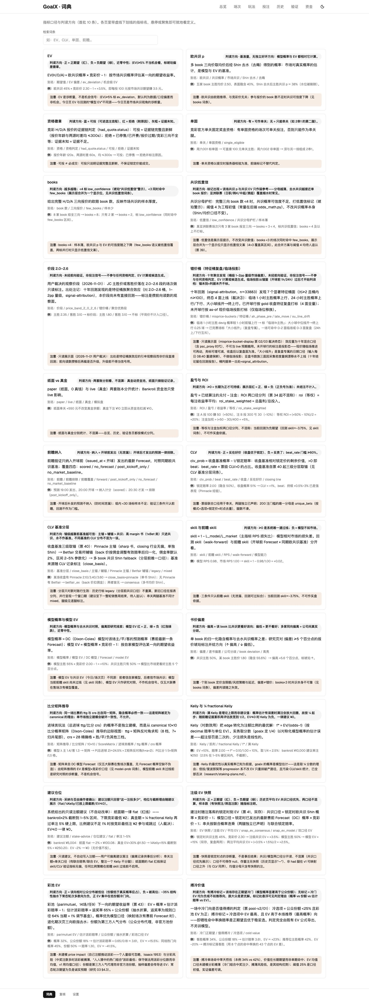

# goalx 产品使用手册（V1）

> 面向**使用者**（非开发者）的操作手册：怎么用这套系统看比赛、构票、锁纸面注、复盘。
> 运维视角（进程/调度/数据源/备份）见 [RUNBOOK](RUNBOOK.md)；术语词典见
> [plans/goalx-quant/glossary.md](plans/goalx-quant/glossary.md)（正式版）与页面 `/glossary`。
> 截图拍摄于 **2026-11-06**（对真实在售场次数据页拍摄；界面随版本演进，UI 变更后由
> `task web-guide-shots` 一条命令重拍）。

## 1. 全链操作路径

一句话流程：**总览发现问题 → 场次/研究页理解依据 → 构票 → 投注页确认 → 锁定 → 历史/验证复盘**。

1. **总览页 `/`（分诊台）**：今天有哪些场、哪些值得看、资金快照。没有候选时看 §5 的归因，先弄清"为什么是 0"。
2. **场次页 `/fixtures`**（今天起 3 天）→ 点进**单场研究页**：

   研究页是一场一档的证据面：竞彩三向价、多书报价（书商名直显，无名书回退编号）、我方模型概率、EV、**资格判定徽章**（可投/拒绝/证据未知+原因）、情报与三轨预测。判断一笔值不值，先在这里看两件事——*模型概率与市场共识差多少*、*报价证据是否新鲜*。
3. **构票**（三个入口，V1 均为纸面）：
   - 胜平负 `/markets/had`：EV×置信排序，单关为主；

   - 进球 `/markets/goals`：比分矩阵推导的总进球/比分；

   - 彩池 `/markets/pool`（14场/任9）与 `/markets/pool4`（四场进球）：**研究构票**，见 §2 边界。

   支持的票型：**HAD 单关**、**两笔独立单关**（singles，预期按 EV×注额 线性合计）、**一注 2 串 1**（parlay，联合 EV = Π(1+EV)−1，全中才赢）。票型选择显式、默认记忆上次。
4. **投注页 `/bets` 确认与锁定**：篮内预览（口径与提交一致）→ 提交 → 建议落库。提交瞬间服务器按锁定时点冻结双口径概率与 EV 快照（共识口径/模型口径分开存、分开读）。

5. **赛后**：赛果自动同步（也可"立即同步"兜底）→ 结算批跑（23:30 自动）→ **历史页 `/history`** 看每注结算与盈亏、**验证页 `/validation`** 看前瞻 skill/CLV/复核三条件进度。

   live 真金回录 = 赛前建建议 + 赛后**人工**回录票据，系统不开任何自动真实执行。

## 2. 各入口身份与责任边界（V1 冻结矩阵）

| 入口 | 身份 | 边界一句话 |
| --- | --- | --- |
| HAD 今日/研究/单关/串关/纸面锁定结算复盘 | **正式纸面核心** | 唯一进正式分母（验证/CLV/EV 快照）的面 |
| 前瞻验证、价格时间线、价格存活 | **正式测量工具** | 测"我们准不准/买得好不好"，不产投注建议 |
| 非 HAD 纸面（goals 等） | 研究样本（`manual_research`） | 记录无偏，但**不进正式分母**，读数侧排除 |
| 彩池（14场/任9/四场进球） | 研究构票 | 奖金**未实现**——纸面组合保持待结算，live 拒绝 |
| LLM（scout/追问）、融合 | 辅助参考 | 永远参考列；真钱资格只读 ML 轨 |
| live 回录 | 人工记账 | 赛前建建议+赛后人工回录，无自动执行动线 |

判断"这个数算不算数"时先对表：进正式分母的只有 HAD 正式纸面核心；其余入口的数字看可以、合计不行。

## 3. 常见失败与恢复

| 情形 | 你会看到 | 怎么办 |
| --- | --- | --- |
| **调价 409**（提交时价已变） | 提交被拒，失败腿带冲突标记留篮 | 按新价重试或移除该腿；重试同键同价幂等回带，**不会重复建注** |
| **意图冲突 409**（同键原提交其实已成功，如响应丢失后改单重提） | 冲突提示 | 恢复原结果；要真改单请换选择/金额（新键）再提——同键改单重提是双注反模式 |
| **停售/已开赛拒绝** | 资格徽章=拒绝，原因可见 | 该场不可投是正确行为，不绕过；换场或等下期 |
| **部分成功** | `第 N 笔失败…（已建 #x，失败腿留篮可重试）` | 成功腿已在账上，只补发失败腿即可 |
| **提交飞行中全局冻结**（防重入机制，2026-11 起） | 提交期间所有页的编辑入口（勾选/换选/改金额）被冻结 | 等本次提交返回自动解冻；冻结是防"重试口径漂移"（提交载荷被中途改掉），刷新页面也可解冻（无在飞提交时门恒开） |
| **无候选** | 总览/今日 0 候选 | 不是错误——按 §5 归因分桶读法定位原因 |

**无候选归因读法**（首页六桶，桶判定与资格判定同源）：未开售 / 数据没采到 / 国际参考断供 / 有价但证据不合格 / 信息齐确实无优势 / 有候选来不及执行。前四桶是**仪器问题**（该修的是采集或匹配），第五桶才是**市场结论**（今天真没优势），第六桶看执行时机。已停售/已开赛单列脚注面。

## 4. 指标判读入门

完整口径以 [glossary 正式版](plans/goalx-quant/glossary.md) 与页面词典 tooltip 为准；本节给判读方向与数字实例。

| 指标 | 一句话判读 | 数字实例 |
| --- | --- | --- |
| EV（今日页） | 市场**共识视角的诊断量**，不是机会信号；\|EV\|≥5% 先怀疑数据/口径偏差 | 竞彩 2.10 × 共识 45% − 1 = −5.5% → 正常范围；−20% 多半是共识分母坏了 |
| 模型 EV（研究页/建注） | 我方概率 × 竞彩价 − 1；正 = 模型认为有价值，**但模型十年结论≈无 skill，正 EV 是候选不是结论** | 模型 52% × 2.10 − 1 = +9.2% → 进候选池，够不够格看资格判定 |
| books / 共识低置信 | 完整三向书数 <3 样本不足；<4 打低置信 | books=2 的共识概率别当真 |
| skill（前瞻） | `1 − L_model/L_market`，**≥0 是唯一通过线**；只认前瞻集合与当前部署版本 | −3.75% = 模型不如市场（十年诚实结论）；+1% 才叫有 skill |
| CLV / beat_rate | 收盘概率 − 1/锁定赔率；>0 = 买在好价；门槛 ≥60% 注占比（200 注起判） | 锁 2.00（隐含 50%），收盘概率 51% → CLV=+1%，beat |
| 搏冷标记 | 冷选项（份额<25%）中 EV 最高且优于推荐向 → 牺牲命中率换赔率是正期望且优于稳妥选 | 客胜 34%/份额 18% → 赔率≈3.61、EV≈+23%，标记落客胜 |

**EV_confirm 四条边界**（确认价 EV，价格实验主指标）：

1. **p_ref 是估计**：参考概率来自 12 书共识去晦，本身有误差——EV_confirm 是相对参考的偏差，不是绝对真值。
2. **bootstrap 不含参考误差**：置信区间只重抽 fixture 簇，**不**把 p_ref 的估计误差算进去——区间窄不等于结论硬。
3. **腿级 ≠ 票级**：EV_confirm 按腿算；2 串 1 的票级 EV 是联合口径（Π(1+EV)−1），腿全正不代表票该下。
4. **最后已知价 ≠ 仍可购**：确认用的是该时点最后有效竞彩价，不证明此刻还能以该价买到——停售/调价随时发生。

## 5. 零注四分法

同样是"今天 0 注"，含义完全不同。先分清是哪一类，再决定动不动手：

| 类 | 含义 | 该做什么 |
| --- | --- | --- |
| **没优势** | 信息齐、判定 valid、就是没有正 EV | 什么都不做——这是系统的正确输出，不下注是纪律不是故障 |
| **没数据** | 该采的没采到（六桶前四桶：未开售/没采到/参考断供/证据不合格） | 修仪器：查晨检、查同步状态，数据问题不产生投注结论 |
| **仪器没跑** | 采集/物化/结算面停摆（栈挂了、任务红） | 修运行面（RUNBOOK §7 故障排查）；停摆期间的分母如实计损 |
| **用户没做** | 有候选、资格齐，你没收口 | 这是唯一一类"该做而没做"——去投注页完成确认 |

四类里只有第四类是使用问题；把"没优势"当故障去折腾、或把"没数据"当"没优势"记录，都会污染后续判读。
