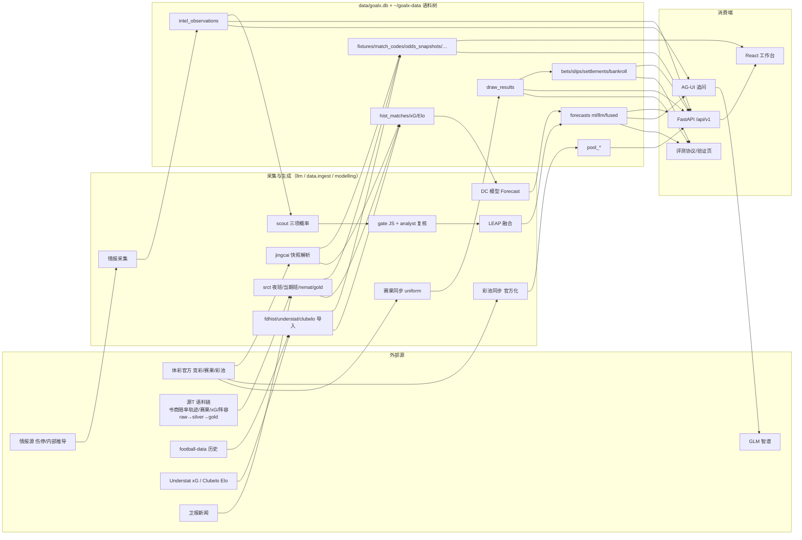

# 数据源与数据流

> 从"外部世界"到"页面上的数字"的完整路径：源 → 采集器 → 表 → 调度 → 消费端。
> 表结构与领域模型见 [db-and-domains.md](./db-and-domains.md)；术语见根 [CONTEXT.md](../CONTEXT.md)。
> 调度时刻表 = `schedules.py` 组合面 + `datasets.py` 注册面（19 deployment 服务，Asia/Shanghai；全量 21 含 2 判死，详见 [RUNBOOK](RUNBOOK.md) §2）。

## 总图

## 逐源明细（2026-11-06 现状）

| # | 源 | 接口/页面 | 采集器 | 落点 | 幂等方式 | 失败语义 |
| --- | --- | --- | --- | --- | --- | --- |
| 1 | sporttery 官方 | 竞彩在售 JSON（五玩法）+ calculator | `data/ingest/sporttery.py` | fixtures/match_codes/odds_snapshots(purpose=live)/sale_statuses + quote_observations | 观测 raw_sha256 + 业务唯一键 | 解析失败抛错（daily-capture 红） |
| 2 | 官方 uniform 族 | 赛果/彩池开奖 | `data/ingest/results.py` | draw_results(+revisions)/draw_sync_runs | 业务键 upsert；更正走 revision 留痕 | pending_manual 人工清单 |
| 3 | **源T 六端点**（语料主链） | 轨迹/赛果/xG/阵容页 | `data/ingest/srct_*` + CorpusStore | `~/goalx-data/` raw→silver→gold；运行面只读桥（欧赔共识、CLV 收盘锚 cid177、今日页 EU 面） | 夜班台账 sha 索引 + 拍键幂等 + remat 水位 | 熔断/断点续传；护栏命中全量兜底 |
| 4 | 体彩官方（传统足彩） | 期次页 | `data/ingest/zucai.py`（票 68 官方化） | pool_periods/pool_matches/pool_sync_runs | 期次+对阵唯一键 | 502/告警 |
| 5 | football-data.co.uk | CSV（五大+N1，5 季+） | `data/ingest/fdhist.py` | hist_matches | 导入幂等 | 单文件失败跳过并计数 |
| 6 | Understat / Clubelo | xG / Elo 页 | `data/ingest/understat.py` 等 | understat_matches / elo_ratings | match_id upsert / (club,valid_from) 区间 | 跳过计数 |
| 7 | 卫报 open platform | 新闻 JSON | `data/ingest/guardian.py` | 语料树（football 段） | 断点续跑 | 500/日预算尽停 |
| 8 | 情报源 | 内部推导 + 伤停页 | `llm/collect.py` 等 | intel_observations | (fixture,collector,raw_hash) 唯一 | 单源故障不阻塞其余源 |
| 9 | GLM（智谱） | OpenAI 兼容端面 | `llm/client.py` + scout/gate/fusion/ask | forecasts(track=llm/fused) + cost_ledger | (fixture,track,content_hash) 幂等 | 熔断三级 60/80/95% |
| 10 | 人工 | UI 录入（开奖/真金出入金/复核/盲评） | API 端点 | draw_results(+revisions)/bankroll_events/review_items/blind_reviews | 业务唯一键；更正必留痕；意图指纹防重（v41） | 服务器校验唯一权威 |
| 11 | ~~The Odds API~~ | 判死备用（2026-09-25：国际赔率全走源T） | — | 历史行 `odds_api:%` 只读 | — | 面不服务 |
| 12 | ~~源B 欧指/PropLine~~ | 判死备用（2026-09-26 终局） | — | 历史语料留档 | — | 面不服务 |

## 调度时刻表（19 deployment，Asia/Shanghai）

时刻表与 cron 以 [RUNBOOK](RUNBOOK.md) §2 为准（组合面 6 + 注册面 13；注册表 `datasets.py` 推导，覆盖不变量 `test_datasets_registry` 执法）。要点：采集主链 = daily-capture 四拍（10:00/12:30/16:30/19:00）+ srct-shift 当期班 + srct-night 夜班；晨链 = 08:10 remat → 08:30 官方对账 → 08:40 gold → 09:05 晨检；日终 23:30 daily-wrap。

拉起方式：`task serve-schedules`（专用 Prefect server + serve 两进程；本机睡眠漏跑如实计入分母）。**合入 main 后必须重启 serve。**

## 消费端

- **API/UI**（contracts/openapi/v1.json 契约先行）：今日/总览页（六桶归因）、场次页/研究页（报价证据+三轨证据链）、彩池页（份额/EV+证据卡）、投注/历史/验证/资金页、复核页（队列+盲评）。
- **AG-UI 追问**（`POST /fixtures/{id}/ask`）：prompt 只注入该场 intel_observations，流式 SSE 回答；无情报不调模型（零成本）；usage 记 cost_ledger(ask)。
- **评测协议**（`/validation/m3-protocol`）：三轨前瞻评分 + 配对 RPS/DM + Tier A/B 冻结阈值状态行——LLM/Fused 永远参考列，真钱资格只读 ML 轨（票 04 冻结）。

## 不变量（跨表）

- append-only 触发器：`odds_snapshots`、`intel_observations` 禁 UPDATE/DELETE（分母铁证与证据层）。
- 开奖/结算更正必须走 revision 留痕（draw_result_revisions / settlement_revisions）。
- forecasts 任何轨不可覆写——更新=追加新行，读取按 (issued_at,id) 最新。
- Bankroll 只受真金记录影响（paper 注单不进资金池）。
- 表 SQL 只出现在归属包（ADR-0008，test_sql_ownership 执法）。
- 语料树发布 = 台账先行（BEGIN IMMEDIATE），官方字节零触碰（票 11 批三）。
