# 数据库与领域模型

> 面向"下一个不了解库的会话"：一页建立表结构、领域归属与生命周期的完整心智模型。
> 术语定义以根目录 [CONTEXT.md](../CONTEXT.md) 为单一事实源，本文不重复定义。
>
> - **生成块**：`<!-- schema-doc:BEGIN/END -->` 标记内（全列表格/ER 图）由 `task schema-doc-export` 从真库生成，**勿手改**（`test_schema_doc.py` 断言漂移）。迁移加列/加表后：重跑导出 + 在速览表补一行。
> - **写权限**：表 SQL 只允许出现在归属包（ADR-0008，`table_owners.py` 登记，执法测试 `test_sql_ownership.py`）。

## 目录

| 节 | 内容 |
| --- | --- |
| [1. 表速览](#t1) | 全部业务表 × 域 × 用途 × 关键口径 × 生命周期，一张总表（计数随迁移演进，以生成块为准） |
| [2. 硬不变量](#t2) | append-only 触发器 / 防前视红线 / 事实源层级等全局铁律 |
| [3. 表间关系（ER）](#t3) | 主键与外键边总览（Mermaid） |
| [4. 全列明细](#t4) | 按域分组的生成块（全表） |

## 1. 表速览

生命周期口径：**append** = 只增不改；**幂等** = 唯一键吸收重复；**upsert** = 最新值覆盖；**种子** = migrations 播种。

### data 域（fixtures / results / pool / ingest）

| 表 | 用途 | 关键口径 | 生命周期 |
| --- | --- | --- | --- |
| `teams` / `competitions` | 队伍与赛事典 | canonical_name 唯一；tier=tier1/tier2 投入分层；odds_api_sport_key=欧赔 join 键 | append |
| `fixtures` | 场次主表（UTC） | odds_api_event_id/join_method/joined_at 记欧赔映射（auto/manual）；stage 杯赛阶段预留 | append（映射列 upsert） |
| `match_codes` | 官方销售编号 | 竞彩"周六001"/池期次场号；business_date=北京业务日；source_match_id=源站场次 id（一跳确定性键） | append+幂等 (kind,business_date,code) |
| `odds_snapshots` | 报价快照 | source（sporttery / odds_api:<book>）、purpose（live_capture/closing）、observation_id→存证 | append+幂等，触发器禁改删 |
| `quote_observations` | 原始报价观测存证（票 35） | endpoint+parse_version+raw_sha256；两次捕获可共用一次观测 | append-only |
| `had_quote_confirmations` | had 报价确认观测关联（报告审计 2026-11-04 票 03） | (observation, fixture) 每次成功观测一行；观测钟读最近确认，同价重采去重后仍可回查 | append-only |
| `sale_statuses` | 销售状态/单固资格时序 | 竞彩快照解析；observation_id 关联 | append |
| `draw_results` | 开奖**唯一事实源** | upsert 可更正（必须走 revision 留痕）；void 标记在此 | upsert+revision |
| `draw_result_revisions` | 开奖更正留痕 | previous/replacement/reason 全存 JSON | append |
| `draw_sync_runs` | 官方赛果同步日志 | uniform 源（票 44 切换；此前源D）；pending_manual 待人工清单 | append |
| `uniform_result_observations` | 官方赛果**观测**（票 44） | UNIQUE(match_id,observed_at)；poolStatus 迁移多跑留痕；join 键=match_codes.source_match_id；终态观测落 draw_results | append-only |
| `draw_reconciliation_runs` | 对账运行日志（票 44） | 参照源（源D/openfootball）vs 事实：一致/比分不一致/void 冲突/缺果 + 待人工清单 | append |
| `source_coverage` | 覆盖现态维表（票 44，定则 4） | 空≠无：absent 断言仅当 covered；coverage_date 语义随源（uniform=matchDate、源D=业务日、openfootball=赛季键、understat=起始年） | upsert |
| `understat_matches` | xG 特征现态（票 45） | 逐场 xG/xGA+npxG/npxGA；prior_*=本季开球日严格早于本场的累计（防前视红线，同日互不可见）；forecast{w,d,l} 仅已赛场次；fixture_id=±1 日+双队名唯一命中 | upsert by match_id |
| `understat_sync_runs` | xG 同步日志 | 逐联赛×赛季计数；results_missing_npxg 金丝雀 | append |
| `elo_ratings` | clubelo Elo 评级层（票 74） | 区间粒度：一行=一队一段同 Elo 的 [valid_from,valid_to]（点时查询与逐日快照等价）；日拍单请求全量快照+--backfill 逐队全历史；club=源侧英文名，中文映射走 team_aliases（消费侧） | upsert (club,valid_from) |
| `srcb_change_rows` / `srcb_change_runs` | 源B欧指变化时序语料（票 49 采集先行） | 行=mid×pid×三向十进制+距开赛分钟（UNIQUE 幂等，行不可变）；无 fixture_id（mid↔身份绑定属消费侧，数值交叉验证后落）；17 核心 pid 每日两拍回溯式 | append-only |
| `pool_periods` / `pool_matches` | 彩池期次与对阵 | euro_odds_*=期次页三向欧指兜底；source_match_id=澳客场次 id | append+幂等 |
| `pool_states` / `public_shares` | 销量/滚存 + 公众份额 | 官方公布 upsert 最新；源B 人气 append（meta 带注数量级） | upsert / append |
| `pool_sync_runs` | 彩池同步日志 | 期次/对阵/份额计数 | append |
| `hist_matches` | fd.co.uk 历史底座 | 五大+N1+扩五联（票 46）含 PSC/AvgC 收盘价——DC 训练与回测分母；开球<6 个月收盘列视为暂定（A5 纪律，data/hygiene.psc_mature） | append+幂等 |
| `admin_match_exclusions` | 行政判赛排除表（A4） | 联赛×队×日期窗——"比分真、比赛假"场次训练集与对账集统一剔除（data/hygiene 单一取数口）；种子=土超 2023 地震两队+2025 阿达纳弃赛 | append（续添只 INSERT） |
| `cost_ledger` | 成本台账 | category+note 是口径维度（llm_call 的 note=model/surface/purpose） | append |

### modelling 域

| 表 | 用途 | 关键口径 | 生命周期 |
| --- | --- | --- | --- |
| `forecasts` | 三轨预测 | track=ml/llm/fused；ml 轨含 xG blend（票 47，model_version dc-xgblend- 前缀溯源）；**ml 轨是真钱资格唯一口径（票 04 冻结），任何轨不可覆写** | append+幂等 (fixture,content_hash) |
| `team_aliases` | 队名别名对齐 | 竞彩名↔训练域↔odds_api 名；source=odds_api/manual | append+幂等 |
| `forecast_coverage` | ML 覆盖普查（auto-paper 票 01） | covered=该场有 track=ml Forecast；skip 三因 reason 取 generate_forecasts 清单；日重跑 REPLACE（派生态非证据） | 普查 REPLACE |

### llm 域（M3）

| 表 | 用途 | 关键口径 | 生命周期 |
| --- | --- | --- | --- |
| `intel_observations` | 情报存证 | UNIQUE(fixture,collector,raw_hash) 幂等——双源同情报各自成行互校验；触发器禁改删 | append-only |
| `divergences` | ML×LLM JS 散度日志 | metric=js_had_ml_llm，重复计算自然累积 | append |
| `review_items` | 复核队列 | route=pre_match（gate JS>0.06 Tier1）/post_settle（赛后一对一错）；结论三分类只进评测集（票 05 冻结） | append+幂等，open→done |
| `blind_reviews` | 盲评双周匿名二选一 | choice=ml/llm | append+幂等 (cycle,fixture) |

### betting 域

| 表 | 用途 | 关键口径 | 生命周期 |
| --- | --- | --- | --- |
| `bets` | 注单 | mode=paper/live；market_kind=fixed/pool；snap_prob_*/snap_ev_*=锁注时点快照（票 41 防泄漏）；状态机 open→won/lost/void/partial | append |
| `bet_slips` / `bet_legs` / `combinations` / `pool_picks` | 票/腿/复式物化/池票选场 | 腿引用锁定 OddsSnapshot；combinations=任9 笛卡尔积落行 | append |
| `settlements` / `settlement_revisions` | 结算与更正留痕 | 单关返本、串关无效腿按 1 继续 | append / append |
| `bankroll_events` | 资金事件 | balance_after 链式核对；**只真金记录进 Bankroll** | append |
| `auto_paper_runs` | auto-v1 锚执行台账（票 03） | 每锚一行 upsert：行存在=跑过；zero_note 区分 no_candidates/no_positive_ev/price_drift/gate_rejected（没跑≠没得买） | upsert（bets/candidates 首写保真 MAX 合并） |

### evaluation 域

| 表 | 用途 | 关键口径 | 生命周期 |
| --- | --- | --- | --- |
| `backtest_runs` / `-predictions` / `-bets` / `-metrics` | 回测四件套 | run（label/params/summary）、prediction（had/fair+model_fingerprint）、bet（kelly/EV）、metric（scope 分层） | append |
| `clv_records` | CLV 对账 | taken_odds vs close_prob；close_basis 分层（pinnacle 主锚/betfair 辅/consensus 兜底） | append+幂等 |
| `haircut_calibrations` | EV 折价校准 | scope×market×source_era 分位 haircut（source_era=证据源代：odds_api/srct/jc_sp）；method_version 随行 | append |
| `market_baseline_snapshots` | 决策锚基准冻结（auto-paper 票 01） | 三锚（12:30/16:30/21:00）write-once：jc_official=JC SP 原始赔率、eu_consensus=Shin 概率（prices JSON 按 source 解释）；as-of=captured_at≤cutoff_at 防锚后到价倒填 | append+幂等 UNIQUE 五元组 |
| `forecast_scores` | 前瞻准确率评分行（auto-paper 票 02） | acc-v1：had/hhad=RPS、ttg/crs/hafu=Brier+log-loss；双基准差值=票 01 快照同窗（缺=unknown NULL）；hhad 仅整数线/hafu 缺半场 → skip_reason 行；派生概率不落库（ADR-0006） | upsert UNIQUE(fixture,market,version)；结果更正 fingerprint 覆盖重评 |
| `edge_findings` | 探索轨发现台账（autoresearch 票 01） | 越门发现一行（scanner/segment/metric_value/n/se/window）；晋升=人裁开验证票（status new→promoted\|dead） | append+幂等 UNIQUE(scanner,segment,window)；status 人裁 UPDATE |
| `edge_observations` | 扫描器运行/观测留痕（autoresearch 票 01/04/02） | s1 逐窗统计快照/s2 模型校准分箱+EV 实现差（票 02：分玩法置信 10 箱 + 纸面注配对差，n≥200 门）/s4 观测日（无信号日记零）/s5 期次回看（滚存标注）；派生态非证据 | 同键 REPLACE 重跑重建 |
| `anchor_sentinel_weekly` | 断点哨兵周级留痕（autoresearch 票 34） | srct（cid177 第一锚，只读）× propline:pinnacle（第二源）周级三轴（coverage_second/coverage_anchor/dev_odds/dev_prob）；1a 分母=cid177 资格场防自反、1b 分母=fixture 侧、signed 周均值禁用（结构零）；alert=留痕+晨检红面不自动处置 | append+幂等（同周重跑追加，读取最新行胜出） |
| `hypothesis_registry` | 假设注册表（vision-build 票 02） | prereg 冻结账：h_id/措辞/判据/数据面/样本量/台账回指（edge-ledger E-xx）+status（registered→running→supported\|refuted，终态恒人 CLI）+attempt_count（家族总尝试，票 04 DSR/BH 分母）；H1-H8 种子在 v51（research/61 §二 原文） | 冻结字段 append（改预测=新 h_id）；status/attempt_count 属主函数 UPDATE；终态留痕不删 |
| `hypothesis_attempts` | 假设逐次评估留痕（vision-build 票 02） | UNIQUE(h_id, window_key) 吸收同窗重扫（scanner 前缀域窗键）；attempt_count 递增的唯一入口 | append-only |
| `contraction_transitions` | 收缩级别 transitions 账（vision-build 票 08） | 五级反向金丝雀（L0…L4）级别变更留痕；genesis=L0，现态=最新行；相邻一级转移（跳级/自环拒绝，重升必经 L2）；级别变更恒人 CLI（actor 哨，agent 无路径） | append-only（触发器拒改写） |
| `contraction_clock_readings` | 收缩双钟读数账（vision-build 票 08） | clv_main=CLV 主钟滚动 183 日窗概率域均值（3% 阈/2SE 单侧/n≥50）；exploration=探索钟 365 日窗幸存者计数（锚点=周批首跑日，票 03 钉）；显式读（人 CLI/月读）落账，晨检只读 | append-only；UNIQUE(clock, window_end) 吸收同窗重读 |
| `llm_proposal_costs` | 周批提案层 LLM 花费账（vision-build 票 03） | 逐调用一行：phase=generate（批次级 B-yyyymmdd）/critique（逐条提案 id）+model/tokens/cost_cny；票 04 月读月度复核消费 | append-only（触发器拒改写） |
| `weekly_agent_state` | 周批空转守卫水位（vision-build 票 03） | face='watermark' 一行：edge_findings 最大 id + 教训库条目数（对比上次周拍，无新料只报心跳不烧 LLM） | face 键 upsert（face_derive_state 同款） |
| `exploration_clock_anchor` | 探索钟锚点一次性钉值账（vision-build 票 03） | id=1 单行：周批首跑日（ensure_exploration_anchor 一次性写入，幂等重跑/后续周拍不覆盖）；读数 DB 行优先、缺席回退常量 | append-only（触发器拒改写）+ id=1 单行约束 |
| `rescan_signal_events` | 四信号触发史账（vision-build 票 04 缝回填，v55） | 月读时点信号面评估落账（odds_psi/jc_rules/league_mix/quarterly_sweep 四信号名 CHECK 钉死；B.3 计时器=读数不落账）；读口=B.3 到期读数/晨检信号面，写口=月读 record_rescan_signals（晨检只读红线） | append-only；UNIQUE(signal, period) 吸收同月重跑 |
| `rag_embeddings` | RAG 向量表两索引共载（vision-build 票 06，v56） | 通用一张：namespace 隔离 `guardian_article`（卫报篇级 chunk，item_id=文章 sid）/`lesson`（教训条目 L-NN）；vec=JSON 数组文本（FLOAT[] 是 DuckDB 检索侧物化形态）；model_id 进主键=换模型旧口径原地保留（换模型=重嵌）；写口=embed_pending 增量管线（CLI rag-embed，content_hash 同跳幂等），读口=DuckDB 暴力余弦 search + 晨检落后条数（只读红线） | upsert UNIQUE(namespace,item_id,model_id)（文本变更重嵌覆盖） |

### infra / 脚手架

| 表 | 用途 | 关键口径 | 生命周期 |
| --- | --- | --- | --- |
| `markets` / `selections` | 玩法与选项字典 | migrations 播种，业务表 FK 引用；无归属包写 | 种子 |

`ev_assessments`（票 03 预留脚手架，自建库起无写入方）已 DROP（票 48
migration v16）——陈盘信号等派生读模型不落表，append-only 原料 +
as-of 纯函数重放即决策存证；EVAssessment 口径在视图与 betting 包函数。

无表实体（口径约定，不落库）：MarketGroup、MatchIntel（票 09 废弃，由 IntelObservation 承接）、EvidenceSummary（视图态）、DecisionKey（betting 包函数口径）、ClosingLine（odds_snapshots.purpose='closing' 切片）、StaleLineSignal（票 48 as-of 纯派生，不落表）。

## 2. 硬不变量

| # | 不变量 | 落点 |
| --- | --- | --- |
| 1 | append-only 铁证（触发器禁 UPDATE/DELETE） | odds_snapshots、forecasts、quote_observations、had_quote_confirmations、sale_statuses、intel_observations、draw_result_revisions、settlement_revisions、draw_sync_runs、pool_sync_runs、uniform_result_observations、draw_reconciliation_runs、understat_sync_runs |
| 2 | 三时间口径（event/published/observed，不伪造） | odds_snapshots.observed_at/source_updated_at；understat_matches 无 published 列（源不提供） |
| 3 | 防前视红线 | understat_matches.prior_* 只累计开球日严格早于本场的完场；Forecast as-of 读取（票 41） |
| 4 | 事实源层级 | draw_results 唯一事实源（官方 uniform 终态导入）；源D/openfootball 仅审计对账，不落事实 |
| 5 | 空≠无（定则 4） | source_coverage 四态 covered/fetched_empty/fetch_failed/not_covered |
| 6 | 预测资格冻结 | ml 轨=真钱唯一口径（票 04）；前瞻评分=赛前最新 Forecast（票 34），模型迭代经 model_version 溯源 |

## 3. 表间关系（ER）

只画主键与外键边；全列细节见[第 4 节](#t4)。可空 FK 用 `}o`（零或多），非空 `}|`（一或多）。

```mermaid
erDiagram
    admin_match_exclusions {
        INTEGER id PK
    }
    anchor_sentinel_weekly {
        INTEGER id PK
    }
    auto_paper_runs {
        TEXT business_date PK
    }
    backtest_bets {
        INTEGER id PK
    }
    backtest_metrics {
        INTEGER id PK
    }
    backtest_predictions {
        INTEGER id PK
    }
    backtest_runs {
        INTEGER id PK
    }
    bankroll_events {
        INTEGER id PK
    }
    bet_legs {
        INTEGER id PK
    }
    bet_price_timeline {
        INTEGER id PK
    }
    bet_slips {
        INTEGER id PK
    }
    bets {
        INTEGER id PK
    }
    blind_reviews {
        INTEGER id PK
    }
    club_pedigree {
        INTEGER id PK
    }
    clv_records {
        INTEGER id PK
    }
    coach_change_events {
        INTEGER id PK
    }
    coach_change_samples {
        INTEGER id PK
    }
    combinations {
        INTEGER id PK
    }
    competitions {
        INTEGER id PK
    }
    contraction_clock_readings {
        INTEGER id PK
    }
    contraction_transitions {
        INTEGER id PK
    }
    cost_ledger {
        INTEGER id PK
    }
    divergences {
        INTEGER id PK
    }
    draw_reconciliation_runs {
        INTEGER id PK
    }
    draw_result_revisions {
        INTEGER id PK
    }
    draw_results {
        INTEGER id PK
    }
    draw_sync_runs {
        INTEGER id PK
    }
    edge_findings {
        INTEGER id PK
    }
    edge_observations {
        TEXT scanner PK
    }
    elo_ratings {
    }
    exploration_clock_anchor {
        INTEGER id PK
    }
    face_derive_state {
        TEXT face PK
    }
    fixtures {
        INTEGER id PK
    }
    forecast_coverage {
        TEXT business_date PK
    }
    forecast_scores {
        INTEGER id PK
    }
    forecasts {
        INTEGER id PK
    }
    formation_family_facet {
        INTEGER id PK
    }
    freshness_shadow {
        INTEGER id PK
    }
    frozen_decision_divergences {
        INTEGER id PK
    }
    frozen_decisions {
        INTEGER id PK
    }
    funnel_days {
        INTEGER id PK
    }
    funnel_fixture_days {
        INTEGER id PK
    }
    had_quote_confirmations {
        INTEGER id PK
    }
    haircut_calibrations {
        INTEGER id PK
    }
    hist_matches {
        INTEGER id PK
    }
    hypothesis_attempts {
        INTEGER id PK
    }
    hypothesis_registry {
        INTEGER id PK
    }
    intel_observations {
        INTEGER id PK
    }
    llm_proposal_costs {
        INTEGER id PK
    }
    market_baseline_snapshots {
        INTEGER id PK
    }
    markets {
        TEXT code PK
    }
    match_codes {
        INTEGER id PK
    }
    odds_snapshots {
        INTEGER id PK
    }
    pool_matches {
        INTEGER id PK
    }
    pool_periods {
        INTEGER id PK
    }
    pool_picks {
        INTEGER id PK
    }
    pool_states {
        INTEGER pool_period_id PK
    }
    pool_sync_runs {
        INTEGER id PK
    }
    price_deviation_ledger {
        INTEGER id PK
    }
    public_shares {
        INTEGER id PK
    }
    quote_observations {
        INTEGER id PK
    }
    rag_embeddings {
        TEXT namespace PK
    }
    rescan_signal_events {
        INTEGER id PK
    }
    review_items {
        INTEGER id PK
    }
    sale_statuses {
        INTEGER id PK
    }
    selections {
        INTEGER id PK
    }
    settlement_revisions {
        INTEGER id PK
    }
    settlements {
        INTEGER id PK
    }
    source_coverage {
        INTEGER id PK
    }
    source_match_links {
        INTEGER id PK
    }
    srcb_change_rows {
        INTEGER id PK
    }
    srcb_change_runs {
        INTEGER id PK
    }
    strategy_versions {
        INTEGER id PK
    }
    team_aliases {
        INTEGER id PK
    }
    teams {
        INTEGER id PK
    }
    tm_club_seasons {
    }
    tm_coach_sync_runs {
        INTEGER id PK
    }
    tm_coach_tenures {
        INTEGER id PK
    }
    track2_snapshots {
        INTEGER id PK
    }
    understat_matches {
        INTEGER id PK
    }
    understat_sync_runs {
        INTEGER id PK
    }
    uniform_result_observations {
        INTEGER id PK
    }
    version_transitions {
        INTEGER id PK
    }
    weekly_agent_state {
        TEXT face PK
    }
    backtest_bets }|--|| backtest_runs : run_id
    backtest_metrics }|--|| backtest_runs : run_id
    backtest_predictions }|--|| backtest_runs : run_id
    bankroll_events }o--|| bet_slips : slip_id
    bankroll_events }o--|| bets : bet_id
    bet_legs }|--|| selections : market_code
    bet_legs }|--|| selections : selection_code
    bet_legs }o--|| odds_snapshots : snapshot_id
    bet_legs }|--|| fixtures : fixture_id
    bet_legs }|--|| bets : bet_id
    bet_price_timeline }o--|| odds_snapshots : snapshot_id
    bet_price_timeline }|--|| bets : bet_id
    bet_slips }o--|| pool_periods : pool_period_id
    bets }o--|| bet_slips : slip_id
    blind_reviews }|--|| fixtures : fixture_id
    clv_records }|--|| fixtures : fixture_id
    clv_records }|--|| bets : bet_id
    coach_change_samples }|--|| hist_matches : hist_match_id
    coach_change_samples }|--|| coach_change_events : event_id
    combinations }|--|| bet_slips : slip_id
    divergences }|--|| fixtures : fixture_id
    draw_result_revisions }|--|| fixtures : fixture_id
    draw_results }|--|| fixtures : fixture_id
    fixtures }|--|| teams : away_team_id
    fixtures }|--|| teams : home_team_id
    fixtures }|--|| competitions : competition_id
    forecast_coverage }|--|| fixtures : fixture_id
    forecast_scores }|--|| fixtures : fixture_id
    forecasts }|--|| fixtures : fixture_id
    had_quote_confirmations }|--|| fixtures : fixture_id
    had_quote_confirmations }|--|| quote_observations : observation_id
    hypothesis_attempts }|--|| hypothesis_registry : h_id
    intel_observations }|--|| fixtures : fixture_id
    market_baseline_snapshots }|--|| fixtures : fixture_id
    match_codes }|--|| fixtures : fixture_id
    odds_snapshots }|--|| selections : market_code
    odds_snapshots }|--|| selections : selection_code
    odds_snapshots }o--|| quote_observations : observation_id
    odds_snapshots }|--|| fixtures : fixture_id
    pool_matches }|--|| pool_periods : pool_period_id
    pool_periods }|--|| markets : market_code
    pool_picks }o--|| fixtures : fixture_id
    pool_picks }|--|| bet_slips : slip_id
    pool_states }o--|| pool_periods : pool_period_id
    public_shares }|--|| pool_periods : pool_period_id
    review_items }|--|| fixtures : fixture_id
    sale_statuses }o--|| quote_observations : observation_id
    sale_statuses }|--|| fixtures : fixture_id
    selections }|--|| markets : market_code
    settlement_revisions }|--|| settlements : settlement_id
    settlements }o--|| bet_slips : slip_id
    settlements }o--|| bets : bet_id
    source_match_links }|--|| fixtures : fixture_id
    team_aliases }|--|| teams : team_id
    understat_matches }o--|| fixtures : fixture_id
    uniform_result_observations }o--|| fixtures : fixture_id
    version_transitions }|--|| strategy_versions : version_id
```

<!-- schema-doc:BEGIN:er -->

<!-- schema-doc:END:er -->

## 4. 全列明细（按域分组，生成块）

*以下各表全列由导出器生成（marker 块内勿手改）。*

### data 域

<!-- schema-doc:BEGIN:table:teams -->
#### `teams`

| 列 | 类型 | 约束 |
| --- | --- | --- |
| `id` | INTEGER | PK |
| `canonical_name` | TEXT | NOT NULL |
| `created_at` | TEXT | NOT NULL |

唯一键 `UNIQUE(`canonical_name`)`
<!-- schema-doc:END:table:teams -->
<!-- schema-doc:BEGIN:table:competitions -->
#### `competitions`

| 列 | 类型 | 约束 |
| --- | --- | --- |
| `id` | INTEGER | PK |
| `name` | TEXT | NOT NULL |
| `tier` | TEXT | NOT NULL，DEFAULT 'tier2' |
| `odds_api_sport_key` | TEXT | — |
| `api_football_league_id` | INTEGER | — |
| `created_at` | TEXT | NOT NULL |

唯一键 `UNIQUE(`name`)`
<!-- schema-doc:END:table:competitions -->
<!-- schema-doc:BEGIN:table:fixtures -->
#### `fixtures`

| 列 | 类型 | 约束 |
| --- | --- | --- |
| `id` | INTEGER | PK |
| `competition_id` | INTEGER | NOT NULL，FK→competitions.id |
| `kickoff_utc` | TEXT | NOT NULL |
| `home_team_id` | INTEGER | NOT NULL，FK→teams.id |
| `away_team_id` | INTEGER | NOT NULL，FK→teams.id |
| `stage` | TEXT | — |
| `odds_api_event_id` | TEXT | — |
| `odds_api_sport_key` | TEXT | — |
| `join_method` | TEXT | — |
| `joined_at` | TEXT | — |
| `propline_event_id` | TEXT | — |
| `propline_sport_key` | TEXT | — |

唯一键 `UNIQUE(`competition_id`, `kickoff_utc`, `home_team_id`, `away_team_id`)`
<!-- schema-doc:END:table:fixtures -->
<!-- schema-doc:BEGIN:table:match_codes -->
#### `match_codes`

| 列 | 类型 | 约束 |
| --- | --- | --- |
| `id` | INTEGER | PK |
| `fixture_id` | INTEGER | NOT NULL，FK→fixtures.id |
| `kind` | TEXT | NOT NULL |
| `business_date` | TEXT | NOT NULL |
| `code` | TEXT | NOT NULL |
| `source_match_id` | TEXT | — |
| `is_single` | INTEGER | — |

唯一键 `UNIQUE(`kind`, `business_date`, `code`)`
<!-- schema-doc:END:table:match_codes -->

<!-- schema-doc:BEGIN:table:source_match_links -->
#### `source_match_links`

| 列 | 类型 | 约束 |
| --- | --- | --- |
| `id` | INTEGER | PK |
| `fixture_id` | INTEGER | NOT NULL，FK→fixtures.id |
| `source` | TEXT | NOT NULL |
| `source_match_id` | TEXT | — |
| `method` | TEXT | — |
| `status` | TEXT | NOT NULL |
| `meta` | TEXT | — |
| `mapped_at` | TEXT | NOT NULL |

唯一键 `UNIQUE(`fixture_id`, `source`)`
<!-- schema-doc:END:table:source_match_links -->

<!-- schema-doc:BEGIN:table:odds_snapshots -->
#### `odds_snapshots`

| 列 | 类型 | 约束 |
| --- | --- | --- |
| `id` | INTEGER | PK |
| `fixture_id` | INTEGER | NOT NULL，FK→fixtures.id |
| `market_code` | TEXT | NOT NULL，FK→selections.market_code |
| `selection_code` | TEXT | NOT NULL，FK→selections.code |
| `source` | TEXT | NOT NULL |
| `purpose` | TEXT | NOT NULL，DEFAULT 'live_capture' |
| `odds` | REAL | NOT NULL |
| `captured_at` | TEXT | NOT NULL |
| `meta` | TEXT | — |
| `created_at` | TEXT | NOT NULL |
| `observed_at` | TEXT | — |
| `source_updated_at` | TEXT | — |
| `observation_id` | INTEGER | FK→quote_observations.id |

唯一键 `UNIQUE(`fixture_id`, `market_code`, `selection_code`, `source`, `captured_at`, `odds`)`

append-only 触发器：`odds_snapshots_no_delete`、`odds_snapshots_no_update`
<!-- schema-doc:END:table:odds_snapshots -->
<!-- schema-doc:BEGIN:table:price_deviation_ledger -->
#### `price_deviation_ledger`

| 列 | 类型 | 约束 |
| --- | --- | --- |
| `id` | INTEGER | PK |
| `fixture_id` | INTEGER | NOT NULL |
| `market_code` | TEXT | NOT NULL |
| `selection_code` | TEXT | NOT NULL |
| `jc_odds` | REAL | NOT NULL |
| `observed_at` | TEXT | NOT NULL |
| `source_updated_at` | TEXT | — |
| `snapshot_id` | INTEGER | NOT NULL |
| `p_sharp_h` | REAL | — |
| `p_sharp_d` | REAL | — |
| `p_sharp_a` | REAL | — |
| `anchor_ref` | TEXT | — |
| `sale_state` | TEXT | — |
| `single_eligible` | INTEGER | — |
| `reference_backfilled_at` | TEXT | — |
| `created_at` | TEXT | NOT NULL |

唯一键 `UNIQUE(`snapshot_id`)`

append-only 触发器：`trg_price_ledger_no_delete`、`trg_price_ledger_no_ref_overwrite`、`trg_price_ledger_no_struct_update`
<!-- schema-doc:END:table:price_deviation_ledger -->

measure-07（v30）：同步报价账本（A 线仪器）——JC 新观测同刻配对源T
Pinnacle 锚（as-of observed_at）与销售态；append-only（删/结构列改触发器
拦截，参考回填列放行 sweep）。

<!-- schema-doc:BEGIN:table:quote_observations -->
#### `quote_observations`

| 列 | 类型 | 约束 |
| --- | --- | --- |
| `id` | INTEGER | PK |
| `source` | TEXT | NOT NULL |
| `purpose` | TEXT | NOT NULL，DEFAULT 'live' |
| `observed_at` | TEXT | NOT NULL |
| `source_updated_at` | TEXT | — |
| `snapshot_at` | TEXT | — |
| `endpoint` | TEXT | — |
| `parse_version` | TEXT | NOT NULL |
| `raw_sha256` | TEXT | NOT NULL |
| `raw_ref` | TEXT | — |
| `summary` | TEXT | — |
| `created_at` | TEXT | NOT NULL |

append-only 触发器：`quote_observations_no_delete`、`quote_observations_no_update`
<!-- schema-doc:END:table:quote_observations -->

报告审计 2026-11-04 票 03（v40）：had 报价确认观测关联——快照自然键
去重吸收同价重采（首见时刻留在快照行），本表按 (observation, fixture)
追加保留每次成功观测；观测钟（jc_observed_at）读最近一次成功确认。
UNIQUE 吸收同证据重解析；不覆写旧快照 observed_at（as-of 重放红线）。

<!-- schema-doc:BEGIN:table:had_quote_confirmations -->
#### `had_quote_confirmations`

| 列 | 类型 | 约束 |
| --- | --- | --- |
| `id` | INTEGER | PK |
| `observation_id` | INTEGER | NOT NULL，FK→quote_observations.id |
| `fixture_id` | INTEGER | NOT NULL，FK→fixtures.id |
| `observed_at` | TEXT | NOT NULL |
| `created_at` | TEXT | NOT NULL |

唯一键 `UNIQUE(`observation_id`, `fixture_id`)`

append-only 触发器：`had_quote_confirmations_no_delete`、`had_quote_confirmations_no_update`
<!-- schema-doc:END:table:had_quote_confirmations -->
<!-- schema-doc:BEGIN:table:sale_statuses -->
#### `sale_statuses`

| 列 | 类型 | 约束 |
| --- | --- | --- |
| `id` | INTEGER | PK |
| `fixture_id` | INTEGER | NOT NULL，FK→fixtures.id |
| `market_code` | TEXT | — |
| `sale_state` | TEXT | NOT NULL |
| `single_eligible` | INTEGER | — |
| `observed_at` | TEXT | NOT NULL |
| `source_updated_at` | TEXT | — |
| `observation_id` | INTEGER | FK→quote_observations.id |
| `created_at` | TEXT | NOT NULL |

append-only 触发器：`sale_statuses_no_delete`、`sale_statuses_no_update`
<!-- schema-doc:END:table:sale_statuses -->
<!-- schema-doc:BEGIN:table:freshness_shadow -->
#### `freshness_shadow`

| 列 | 类型 | 约束 |
| --- | --- | --- |
| `id` | INTEGER | PK |
| `fixture_id` | INTEGER | NOT NULL |
| `business_date` | TEXT | NOT NULL |
| `as_of` | TEXT | NOT NULL |
| `rule_stale_source` | INTEGER | NOT NULL |
| `observed_stale` | INTEGER | NOT NULL |
| `price_age_seconds` | REAL | — |
| `observed_age_seconds` | REAL | — |
| `clock_gap_seconds` | REAL | — |
| `sale_age_seconds` | REAL | — |
| `eu_age_seconds` | REAL | — |
| `pair_gap_seconds` | REAL | — |

唯一键 `UNIQUE(`fixture_id`, `business_date`)`
<!-- schema-doc:END:table:freshness_shadow -->
<!-- schema-doc:BEGIN:table:draw_results -->
#### `draw_results`

| 列 | 类型 | 约束 |
| --- | --- | --- |
| `id` | INTEGER | PK |
| `fixture_id` | INTEGER | NOT NULL，FK→fixtures.id |
| `home_goals` | INTEGER | NOT NULL |
| `away_goals` | INTEGER | NOT NULL |
| `half_home_goals` | INTEGER | — |
| `half_away_goals` | INTEGER | — |
| `void` | INTEGER | NOT NULL，DEFAULT 0 |
| `void_reason` | TEXT | — |
| `source` | TEXT | NOT NULL |
| `published_at` | TEXT | — |
| `created_at` | TEXT | NOT NULL |

唯一键 `UNIQUE(`fixture_id`)`
<!-- schema-doc:END:table:draw_results -->
<!-- schema-doc:BEGIN:table:draw_result_revisions -->
#### `draw_result_revisions`

| 列 | 类型 | 约束 |
| --- | --- | --- |
| `id` | INTEGER | PK |
| `fixture_id` | INTEGER | NOT NULL，FK→fixtures.id |
| `previous` | TEXT | NOT NULL |
| `replacement` | TEXT | NOT NULL |
| `reason` | TEXT | NOT NULL |
| `recorded_at` | TEXT | NOT NULL |

append-only 触发器：`draw_result_revisions_no_delete`、`draw_result_revisions_no_update`
<!-- schema-doc:END:table:draw_result_revisions -->
<!-- schema-doc:BEGIN:table:draw_sync_runs -->
#### `draw_sync_runs`

| 列 | 类型 | 约束 |
| --- | --- | --- |
| `id` | INTEGER | PK |
| `source` | TEXT | NOT NULL |
| `observed_at` | TEXT | NOT NULL |
| `business_dates` | TEXT | NOT NULL |
| `pages` | INTEGER | NOT NULL |
| `fetched` | INTEGER | NOT NULL |
| `imported` | INTEGER | NOT NULL |
| `unchanged` | INTEGER | NOT NULL |
| `unmatched` | INTEGER | NOT NULL |
| `pending_manual` | TEXT | NOT NULL |
| `parse_version` | TEXT | NOT NULL |
| `created_at` | TEXT | NOT NULL |

append-only 触发器：`draw_sync_runs_no_delete`、`draw_sync_runs_no_update`
<!-- schema-doc:END:table:draw_sync_runs -->
<!-- schema-doc:BEGIN:table:uniform_result_observations -->
#### `uniform_result_observations`

| 列 | 类型 | 约束 |
| --- | --- | --- |
| `id` | INTEGER | PK |
| `match_id` | INTEGER | NOT NULL |
| `match_num_str` | TEXT | NOT NULL |
| `match_date` | TEXT | NOT NULL |
| `business_date` | TEXT | — |
| `fixture_id` | INTEGER | FK→fixtures.id |
| `league_id` | INTEGER | — |
| `league_name` | TEXT | — |
| `result_status` | TEXT | NOT NULL |
| `pool_status` | TEXT | — |
| `full_score_raw` | TEXT | — |
| `half_score_raw` | TEXT | — |
| `home_goals` | INTEGER | — |
| `away_goals` | INTEGER | — |
| `half_home_goals` | INTEGER | — |
| `half_away_goals` | INTEGER | — |
| `win_flag` | TEXT | — |
| `odds_h` | TEXT | — |
| `odds_d` | TEXT | — |
| `odds_a` | TEXT | — |
| `goal_line` | TEXT | — |
| `betting_single` | INTEGER | — |
| `void_flag` | INTEGER | NOT NULL，DEFAULT 0 |
| `void_reason` | TEXT | — |
| `observed_at` | TEXT | NOT NULL |
| `parse_version` | TEXT | NOT NULL |
| `created_at` | TEXT | NOT NULL |

唯一键 `UNIQUE(`match_id`, `observed_at`)`

append-only 触发器：`uniform_result_observations_no_delete`、`uniform_result_observations_no_update`
<!-- schema-doc:END:table:uniform_result_observations -->
<!-- schema-doc:BEGIN:table:draw_reconciliation_runs -->
#### `draw_reconciliation_runs`

| 列 | 类型 | 约束 |
| --- | --- | --- |
| `id` | INTEGER | PK |
| `source` | TEXT | NOT NULL |
| `observed_at` | TEXT | NOT NULL |
| `business_dates` | TEXT | NOT NULL |
| `compared` | INTEGER | NOT NULL，DEFAULT 0 |
| `consistent` | INTEGER | NOT NULL，DEFAULT 0 |
| `score_mismatch` | INTEGER | NOT NULL，DEFAULT 0 |
| `void_mismatch` | INTEGER | NOT NULL，DEFAULT 0 |
| `missing_result` | INTEGER | NOT NULL，DEFAULT 0 |
| `unmatched` | INTEGER | NOT NULL，DEFAULT 0 |
| `pending_manual` | TEXT | NOT NULL |
| `parse_version` | TEXT | NOT NULL |
| `created_at` | TEXT | NOT NULL |

append-only 触发器：`draw_reconciliation_runs_no_delete`、`draw_reconciliation_runs_no_update`
<!-- schema-doc:END:table:draw_reconciliation_runs -->
<!-- schema-doc:BEGIN:table:source_coverage -->
#### `source_coverage`

| 列 | 类型 | 约束 |
| --- | --- | --- |
| `id` | INTEGER | PK |
| `source` | TEXT | NOT NULL |
| `coverage_date` | TEXT | NOT NULL |
| `league_key` | TEXT | NOT NULL，DEFAULT '' |
| `league_name` | TEXT | — |
| `match_count` | INTEGER | NOT NULL，DEFAULT 0 |
| `coverage_status` | TEXT | NOT NULL |
| `observed_at` | TEXT | NOT NULL |
| `created_at` | TEXT | NOT NULL |
| `updated_at` | TEXT | NOT NULL |

唯一键 `UNIQUE(`source`, `coverage_date`, `league_key`)`
<!-- schema-doc:END:table:source_coverage -->
<!-- schema-doc:BEGIN:table:understat_matches -->
#### `understat_matches`

| 列 | 类型 | 约束 |
| --- | --- | --- |
| `id` | INTEGER | PK |
| `match_id` | TEXT | NOT NULL |
| `league` | TEXT | NOT NULL |
| `season` | TEXT | NOT NULL |
| `datetime_utc` | TEXT | NOT NULL |
| `home_team_id` | TEXT | NOT NULL |
| `home_team` | TEXT | NOT NULL |
| `away_team_id` | TEXT | NOT NULL |
| `away_team` | TEXT | NOT NULL |
| `is_result` | INTEGER | NOT NULL，DEFAULT 0 |
| `goals_home` | INTEGER | — |
| `goals_away` | INTEGER | — |
| `xg_home` | REAL | — |
| `xg_away` | REAL | — |
| `npxg_home` | REAL | — |
| `npxg_away` | REAL | — |
| `prior_npxg_home` | REAL | — |
| `prior_npxga_home` | REAL | — |
| `prior_matches_home` | INTEGER | — |
| `prior_npxg_away` | REAL | — |
| `prior_npxga_away` | REAL | — |
| `prior_matches_away` | INTEGER | — |
| `forecast_w` | REAL | — |
| `forecast_d` | REAL | — |
| `forecast_l` | REAL | — |
| `fixture_id` | INTEGER | FK→fixtures.id |
| `first_seen_at` | TEXT | NOT NULL |
| `observed_at` | TEXT | NOT NULL |

唯一键 `UNIQUE(`match_id`)`
<!-- schema-doc:END:table:understat_matches -->
<!-- schema-doc:BEGIN:table:understat_sync_runs -->
#### `understat_sync_runs`

| 列 | 类型 | 约束 |
| --- | --- | --- |
| `id` | INTEGER | PK |
| `source` | TEXT | NOT NULL |
| `observed_at` | TEXT | NOT NULL |
| `seasons` | TEXT | NOT NULL |
| `matches` | INTEGER | NOT NULL |
| `results` | INTEGER | NOT NULL |
| `joined` | INTEGER | NOT NULL |
| `unmatched` | INTEGER | NOT NULL |
| `failed` | INTEGER | NOT NULL |
| `parse_version` | TEXT | NOT NULL |
| `created_at` | TEXT | NOT NULL |

append-only 触发器：`understat_sync_runs_no_delete`、`understat_sync_runs_no_update`
<!-- schema-doc:END:table:understat_sync_runs -->

<!-- schema-doc:BEGIN:table:elo_ratings -->
#### `elo_ratings`

| 列 | 类型 | 约束 |
| --- | --- | --- |
| `club` | TEXT | NOT NULL |
| `country` | TEXT | NOT NULL |
| `level` | INTEGER | — |
| `elo` | REAL | NOT NULL |
| `valid_from` | TEXT | NOT NULL |
| `valid_to` | TEXT | — |

唯一键 `UNIQUE(`club`, `valid_from`)`
<!-- schema-doc:END:table:elo_ratings -->

<!-- schema-doc:BEGIN:table:srcb_change_rows -->
#### `srcb_change_rows`

| 列 | 类型 | 约束 |
| --- | --- | --- |
| `id` | INTEGER | PK |
| `mid` | TEXT | NOT NULL |
| `pid` | TEXT | NOT NULL |
| `odds_h` | REAL | NOT NULL |
| `odds_d` | REAL | NOT NULL |
| `odds_a` | REAL | NOT NULL |
| `minutes_before` | INTEGER | NOT NULL |
| `time_label` | TEXT | NOT NULL |
| `observed_at` | TEXT | NOT NULL |
| `first_seen_at` | TEXT | NOT NULL |

唯一键 `UNIQUE(`mid`, `pid`, `minutes_before`, `odds_h`, `odds_d`, `odds_a`)`
<!-- schema-doc:END:table:srcb_change_rows -->

<!-- schema-doc:BEGIN:table:srcb_change_runs -->
#### `srcb_change_runs`

| 列 | 类型 | 约束 |
| --- | --- | --- |
| `id` | INTEGER | PK |
| `observed_at` | TEXT | NOT NULL |
| `mids` | TEXT | NOT NULL |
| `pids` | TEXT | NOT NULL |
| `requests` | INTEGER | NOT NULL |
| `rows_added` | INTEGER | NOT NULL |
| `rows_absorbed` | INTEGER | NOT NULL |
| `failed` | TEXT | NOT NULL |
| `parse_version` | TEXT | NOT NULL |
| `created_at` | TEXT | NOT NULL |

append-only 触发器：`srcb_change_runs_no_delete`、`srcb_change_runs_no_update`
<!-- schema-doc:END:table:srcb_change_runs -->

<!-- schema-doc:BEGIN:table:pool_periods -->
#### `pool_periods`

| 列 | 类型 | 约束 |
| --- | --- | --- |
| `id` | INTEGER | PK |
| `market_code` | TEXT | NOT NULL，FK→markets.code |
| `period_no` | TEXT | NOT NULL |
| `sales_deadline` | TEXT | — |

唯一键 `UNIQUE(`market_code`, `period_no`)`
<!-- schema-doc:END:table:pool_periods -->
<!-- schema-doc:BEGIN:table:pool_matches -->
#### `pool_matches`

| 列 | 类型 | 约束 |
| --- | --- | --- |
| `id` | INTEGER | PK |
| `pool_period_id` | INTEGER | NOT NULL，FK→pool_periods.id |
| `match_seq` | INTEGER | NOT NULL |
| `source_match_id` | TEXT | — |
| `league` | TEXT | — |
| `kickoff_utc` | TEXT | NOT NULL |
| `home_team` | TEXT | NOT NULL |
| `away_team` | TEXT | NOT NULL |
| `euro_odds_h` | REAL | — |
| `euro_odds_d` | REAL | — |
| `euro_odds_a` | REAL | — |

唯一键 `UNIQUE(`pool_period_id`, `match_seq`)`
<!-- schema-doc:END:table:pool_matches -->
<!-- schema-doc:BEGIN:table:pool_states -->
#### `pool_states`

| 列 | 类型 | 约束 |
| --- | --- | --- |
| `pool_period_id` | INTEGER | PK，FK→pool_periods.id |
| `sales_amount` | REAL | — |
| `rollover_in` | REAL | — |
| `prize_tiers` | TEXT | — |
| `published_at` | TEXT | — |
<!-- schema-doc:END:table:pool_states -->
<!-- schema-doc:BEGIN:table:public_shares -->
#### `public_shares`

| 列 | 类型 | 约束 |
| --- | --- | --- |
| `id` | INTEGER | PK |
| `pool_period_id` | INTEGER | NOT NULL，FK→pool_periods.id |
| `match_seq` | INTEGER | NOT NULL |
| `selection_code` | TEXT | NOT NULL |
| `share` | REAL | NOT NULL |
| `origin` | TEXT | NOT NULL |
| `source` | TEXT | NOT NULL |
| `captured_at` | TEXT | NOT NULL |
| `meta` | TEXT | — |

唯一键 `UNIQUE(`pool_period_id`, `match_seq`, `selection_code`, `origin`, `source`, `captured_at`)`
<!-- schema-doc:END:table:public_shares -->
<!-- schema-doc:BEGIN:table:pool_sync_runs -->
#### `pool_sync_runs`

| 列 | 类型 | 约束 |
| --- | --- | --- |
| `id` | INTEGER | PK |
| `source` | TEXT | NOT NULL |
| `observed_at` | TEXT | NOT NULL |
| `period_nos` | TEXT | NOT NULL |
| `pages` | INTEGER | NOT NULL |
| `matches` | INTEGER | NOT NULL |
| `share_rows` | INTEGER | NOT NULL |
| `missing_shares` | INTEGER | NOT NULL |
| `parse_version` | TEXT | NOT NULL |
| `created_at` | TEXT | NOT NULL |
| `empty_markets` | TEXT | — |

append-only 触发器：`pool_sync_runs_no_delete`、`pool_sync_runs_no_update`
<!-- schema-doc:END:table:pool_sync_runs -->
<!-- schema-doc:BEGIN:table:hist_matches -->
#### `hist_matches`

| 列 | 类型 | 约束 |
| --- | --- | --- |
| `id` | INTEGER | PK |
| `competition` | TEXT | NOT NULL |
| `season` | TEXT | NOT NULL |
| `match_date` | TEXT | NOT NULL |
| `home_team` | TEXT | NOT NULL |
| `away_team` | TEXT | NOT NULL |
| `fthg` | INTEGER | NOT NULL |
| `ftag` | INTEGER | NOT NULL |
| `ftr` | TEXT | NOT NULL |
| `psc_home` | REAL | — |
| `psc_draw` | REAL | — |
| `psc_away` | REAL | — |
| `avgc_home` | REAL | — |
| `avgc_draw` | REAL | — |
| `avgc_away` | REAL | — |
| `psh_home` | REAL | — |
| `psh_draw` | REAL | — |
| `psh_away` | REAL | — |
| `avg_ou_over` | REAL | — |
| `avg_ou_under` | REAL | — |
| `avgc_ou_over` | REAL | — |
| `avgc_ou_under` | REAL | — |
| `ah_line` | REAL | — |
| `avg_ah_home` | REAL | — |
| `avg_ah_away` | REAL | — |
| `ahc_line` | REAL | — |
| `avgc_ah_home` | REAL | — |
| `avgc_ah_away` | REAL | — |
| `hthg` | INTEGER | — |
| `htag` | INTEGER | — |
| `htr` | TEXT | — |
| `referee` | TEXT | — |
| `shots_home` | INTEGER | — |
| `shots_away` | INTEGER | — |
| `shots_on_target_home` | INTEGER | — |
| `shots_on_target_away` | INTEGER | — |
| `corners_home` | INTEGER | — |
| `corners_away` | INTEGER | — |
| `fouls_home` | INTEGER | — |
| `fouls_away` | INTEGER | — |
| `yellow_home` | INTEGER | — |
| `yellow_away` | INTEGER | — |
| `red_home` | INTEGER | — |
| `red_away` | INTEGER | — |

唯一键 `UNIQUE(`competition`, `season`, `match_date`, `home_team`, `away_team`)`
<!-- schema-doc:END:table:hist_matches -->

<!-- schema-doc:BEGIN:table:admin_match_exclusions -->
#### `admin_match_exclusions`

| 列 | 类型 | 约束 |
| --- | --- | --- |
| `id` | INTEGER | PK |
| `competition` | TEXT | NOT NULL |
| `team` | TEXT | NOT NULL |
| `date_start` | TEXT | NOT NULL |
| `date_end` | TEXT | NOT NULL |
| `reason` | TEXT | NOT NULL |
| `created_at` | TEXT | NOT NULL |

唯一键 `UNIQUE(`competition`, `team`, `date_start`, `date_end`)`

append-only 触发器：`admin_match_exclusions_no_delete`、`admin_match_exclusions_no_update`
<!-- schema-doc:END:table:admin_match_exclusions -->
<!-- schema-doc:BEGIN:table:cost_ledger -->
#### `cost_ledger`

| 列 | 类型 | 约束 |
| --- | --- | --- |
| `id` | INTEGER | PK |
| `occurred_at` | TEXT | NOT NULL |
| `category` | TEXT | NOT NULL |
| `units` | REAL | NOT NULL，DEFAULT 1 |
| `amount_cny` | REAL | NOT NULL，DEFAULT 0 |
| `note` | TEXT | — |
| `meta` | TEXT | — |
<!-- schema-doc:END:table:cost_ledger -->
<!-- schema-doc:BEGIN:table:tm_coach_tenures -->
#### `tm_coach_tenures`

| 列 | 类型 | 约束 |
| --- | --- | --- |
| `id` | INTEGER | PK |
| `club_tm_id` | INTEGER | NOT NULL |
| `club_name` | TEXT | NOT NULL |
| `role` | TEXT | NOT NULL |
| `coach_tm_id` | INTEGER | — |
| `coach_name` | TEXT | NOT NULL |
| `date_from` | TEXT | NOT NULL |
| `date_to` | TEXT | — |
| `games` | INTEGER | — |
| `first_seen_at` | TEXT | NOT NULL |
| `observed_at` | TEXT | NOT NULL |
| `parse_version` | TEXT | NOT NULL |

唯一键 `UNIQUE(`club_tm_id`, `role`, `coach_name`, `date_from`)`
<!-- schema-doc:END:table:tm_coach_tenures -->
<!-- schema-doc:BEGIN:table:tm_club_seasons -->
#### `tm_club_seasons`

| 列 | 类型 | 约束 |
| --- | --- | --- |
| `league_tm_code` | TEXT | NOT NULL |
| `season` | TEXT | NOT NULL |
| `club_tm_id` | INTEGER | NOT NULL |
| `club_name` | TEXT | NOT NULL |
| `first_seen_at` | TEXT | NOT NULL |
| `observed_at` | TEXT | NOT NULL |

唯一键 `UNIQUE(`league_tm_code`, `season`, `club_tm_id`)`
<!-- schema-doc:END:table:tm_club_seasons -->
<!-- schema-doc:BEGIN:table:coach_change_events -->
#### `coach_change_events`

| 列 | 类型 | 约束 |
| --- | --- | --- |
| `id` | INTEGER | PK |
| `club_tm_id` | INTEGER | NOT NULL |
| `club_name` | TEXT | NOT NULL |
| `hist_competition` | TEXT | NOT NULL |
| `hist_season` | TEXT | NOT NULL |
| `event_date` | TEXT | NOT NULL |
| `outgoing_coach` | TEXT | — |
| `outgoing_is_caretaker` | INTEGER | — |
| `incoming_coach` | TEXT | NOT NULL |
| `incoming_is_caretaker` | INTEGER | NOT NULL |
| `team_id` | INTEGER | — |
| `rebuilt_at` | TEXT | NOT NULL |

唯一键 `UNIQUE(`club_tm_id`, `event_date`, `incoming_coach`)`
<!-- schema-doc:END:table:coach_change_events -->
<!-- schema-doc:BEGIN:table:coach_change_samples -->
#### `coach_change_samples`

| 列 | 类型 | 约束 |
| --- | --- | --- |
| `id` | INTEGER | PK |
| `event_id` | INTEGER | NOT NULL，FK→coach_change_events.id |
| `hist_match_id` | INTEGER | NOT NULL，FK→hist_matches.id |
| `game_no` | INTEGER | NOT NULL |
| `rebuilt_at` | TEXT | NOT NULL |

唯一键 `UNIQUE(`event_id`, `game_no`)`
<!-- schema-doc:END:table:coach_change_samples -->
<!-- schema-doc:BEGIN:table:tm_coach_sync_runs -->
#### `tm_coach_sync_runs`

| 列 | 类型 | 约束 |
| --- | --- | --- |
| `id` | INTEGER | PK |
| `observed_at` | TEXT | NOT NULL |
| `leagues` | TEXT | NOT NULL |
| `clubs` | INTEGER | NOT NULL |
| `tenure_rows` | INTEGER | NOT NULL |
| `written` | INTEGER | NOT NULL |
| `failed` | TEXT | NOT NULL |
| `parse_version` | TEXT | NOT NULL |
| `created_at` | TEXT | NOT NULL |

append-only 触发器：`tm_coach_sync_runs_no_delete`、`tm_coach_sync_runs_no_update`
<!-- schema-doc:END:table:tm_coach_sync_runs -->
<!-- schema-doc:BEGIN:table:formation_family_facet -->
#### `formation_family_facet`

| 列 | 类型 | 约束 |
| --- | --- | --- |
| `id` | INTEGER | PK |
| `season` | TEXT | NOT NULL |
| `league_fd` | TEXT | — |
| `league_zh` | TEXT | NOT NULL |
| `team_id` | INTEGER | NOT NULL |
| `club_tm_id` | INTEGER | NOT NULL |
| `club_name` | TEXT | NOT NULL |
| `coach_name` | TEXT | NOT NULL |
| `coach_role` | TEXT | NOT NULL |
| `family` | TEXT | NOT NULL |
| `n_matches` | INTEGER | NOT NULL |
| `n_known` | INTEGER | NOT NULL |
| `first_match_date` | TEXT | NOT NULL |
| `last_match_date` | TEXT | NOT NULL |
| `rebuilt_at` | TEXT | NOT NULL |

唯一键 `UNIQUE(`season`, `league_zh`, `club_tm_id`, `coach_name`, `family`)`
<!-- schema-doc:END:table:formation_family_facet -->

六轴 ② 阵型族条件面（票 09；data/formations.py 派生重建，DELETE+INSERT
非事实面）。族字典受控（未匹配归 `other`）；教练=manager-of-the-day
指派（TM 英文名空间，中文名不入面）；PIT 读缝 `coach_family_prior` 只取
查询时点前已完结格子（不含当场面）。覆盖报告只出英超+英冠切片；
TM 多别名逐名试解（F7）；开球缺失场独立分桶（F8）。

<!-- schema-doc:BEGIN:table:club_pedigree -->
#### `club_pedigree`

| 列 | 类型 | 约束 |
| --- | --- | --- |
| `id` | INTEGER | PK |
| `team` | TEXT | NOT NULL |
| `season` | TEXT | NOT NULL |
| `top_flight_streak` | INTEGER | — |
| `points_pct_l5` | REAL | — |
| `l5_seasons` | INTEGER | NOT NULL |
| `tier1_titles` | INTEGER | — |
| `major_honours` | INTEGER | — |
| `promo_to_tier1` | INTEGER | — |
| `releg_from_tier1` | INTEGER | — |
| `club_tm_id` | INTEGER | — |
| `rebuilt_at` | TEXT | NOT NULL |

唯一键 `UNIQUE(`team`, `season`)`
<!-- schema-doc:END:table:club_pedigree -->

六轴 ④ 底蕴硬层四因子面（票 09；data/pedigree.py 派生重建）。四因子
独立列不合成：连续年限=截至上一赛季（tm_club_seasons，顶级口径=逐国
顶级，F1）、近 5 季积分百分位=前 5 季均值（hist 逐场 3-1-0）、荣誉=
HONOURS 受控常量（tier1_titles=as-of-season：全史总数 − 窗内后置赛季
冠军数，F4；major_honours=静态先验——窗内年份带前视增量，消费方
EM facet 签字可用）、升降级频谱=纯后视窗 tier1 出入计数。TM 未解析
队年限/频谱=NULL；荣誉种子未命中/互撞两列 NULL 不写假 0（F2/F3/F6）。
荣誉数字出处（F5 逐条复核）见 data/pedigree.py 常量注记。
<!-- schema-doc:BEGIN:table:face_derive_state -->
#### `face_derive_state`

| 列 | 类型 | 约束 |
| --- | --- | --- |
| `face` | TEXT | PK |
| `rebuilt_at` | TEXT | NOT NULL |
| `stats` | TEXT | NOT NULL |

唯一键 `UNIQUE(`face`)`
<!-- schema-doc:END:table:face_derive_state -->
### modelling 域

<!-- schema-doc:BEGIN:table:forecasts -->
#### `forecasts`

| 列 | 类型 | 约束 |
| --- | --- | --- |
| `id` | INTEGER | PK |
| `fixture_id` | INTEGER | NOT NULL，FK→fixtures.id |
| `track` | TEXT | NOT NULL |
| `model_version` | TEXT | NOT NULL |
| `issued_at` | TEXT | NOT NULL |
| `content_hash` | TEXT | NOT NULL |
| `payload` | TEXT | NOT NULL |

唯一键 `UNIQUE(`fixture_id`, `content_hash`)`

append-only 触发器：`forecasts_no_delete`、`forecasts_no_update`
<!-- schema-doc:END:table:forecasts -->
<!-- schema-doc:BEGIN:table:team_aliases -->
#### `team_aliases`

| 列 | 类型 | 约束 |
| --- | --- | --- |
| `id` | INTEGER | PK |
| `team_id` | INTEGER | NOT NULL，FK→teams.id |
| `source` | TEXT | NOT NULL |
| `alias` | TEXT | NOT NULL |

唯一键 `UNIQUE(`source`, `alias`)`
<!-- schema-doc:END:table:team_aliases -->
<!-- schema-doc:BEGIN:table:forecast_coverage -->
#### `forecast_coverage`

| 列 | 类型 | 约束 |
| --- | --- | --- |
| `business_date` | TEXT | PK，NOT NULL |
| `fixture_id` | INTEGER | PK，NOT NULL，FK→fixtures.id |
| `covered` | INTEGER | NOT NULL |
| `reason` | TEXT | — |
| `detail` | TEXT | — |
| `recorded_at` | TEXT | NOT NULL |

唯一键 `UNIQUE(`business_date`, `fixture_id`)`
<!-- schema-doc:END:table:forecast_coverage -->
<!-- schema-doc:BEGIN:table:forecast_scores -->
#### `forecast_scores`

| 列 | 类型 | 约束 |
| --- | --- | --- |
| `id` | INTEGER | PK |
| `fixture_id` | INTEGER | NOT NULL，FK→fixtures.id |
| `market` | TEXT | NOT NULL |
| `month_key` | TEXT | NOT NULL |
| `kickoff_utc` | TEXT | NOT NULL |
| `competition` | TEXT | NOT NULL |
| `score_version` | TEXT | NOT NULL |
| `forecast_id` | INTEGER | NOT NULL |
| `model_metric` | REAL | — |
| `model_logloss` | REAL | — |
| `jc_baseline_metric` | REAL | — |
| `eu_baseline_metric` | REAL | — |
| `diff_jc` | REAL | — |
| `diff_eu` | REAL | — |
| `pred_prob_outcome` | REAL | — |
| `outcome` | TEXT | NOT NULL |
| `hhad_goal_line` | REAL | — |
| `skip_reason` | TEXT | — |
| `result_fingerprint` | TEXT | NOT NULL |
| `scored_at` | TEXT | NOT NULL |

唯一键 `UNIQUE(`fixture_id`, `market`, `score_version`)`
<!-- schema-doc:END:table:forecast_scores -->
<!-- schema-doc:BEGIN:table:edge_findings -->
#### `edge_findings`

| 列 | 类型 | 约束 |
| --- | --- | --- |
| `id` | INTEGER | PK |
| `scanner` | TEXT | NOT NULL |
| `segment_key` | TEXT | NOT NULL |
| `metric_value` | REAL | NOT NULL |
| `n` | INTEGER | NOT NULL |
| `se` | REAL | NOT NULL |
| `window` | TEXT | NOT NULL |
| `status` | TEXT | NOT NULL，DEFAULT 'new' |
| `found_at` | TEXT | NOT NULL |
| `notes` | TEXT | — |

唯一键 `UNIQUE(`scanner`, `segment_key`, `window`)`
<!-- schema-doc:END:table:edge_findings -->
<!-- schema-doc:BEGIN:table:edge_observations -->
#### `edge_observations`

| 列 | 类型 | 约束 |
| --- | --- | --- |
| `scanner` | TEXT | PK，NOT NULL |
| `window_key` | TEXT | PK，NOT NULL |
| `payload` | TEXT | NOT NULL |
| `created_at` | TEXT | NOT NULL |

唯一键 `UNIQUE(`scanner`, `window_key`)`
<!-- schema-doc:END:table:edge_observations -->
### llm 域

<!-- schema-doc:BEGIN:table:intel_observations -->
#### `intel_observations`

| 列 | 类型 | 约束 |
| --- | --- | --- |
| `id` | INTEGER | PK |
| `fixture_id` | INTEGER | NOT NULL，FK→fixtures.id |
| `kind` | TEXT | NOT NULL |
| `text` | TEXT | NOT NULL |
| `source` | TEXT | NOT NULL |
| `collected_at` | TEXT | NOT NULL |
| `collector` | TEXT | NOT NULL |
| `raw_payload` | TEXT | NOT NULL |
| `raw_hash` | TEXT | NOT NULL |
| `created_at` | TEXT | NOT NULL |

唯一键 `UNIQUE(`fixture_id`, `collector`, `raw_hash`)`

append-only 触发器：`intel_observations_no_delete`、`intel_observations_no_update`
<!-- schema-doc:END:table:intel_observations -->
<!-- schema-doc:BEGIN:table:divergences -->
#### `divergences`

| 列 | 类型 | 约束 |
| --- | --- | --- |
| `id` | INTEGER | PK |
| `fixture_id` | INTEGER | NOT NULL，FK→fixtures.id |
| `metric` | TEXT | NOT NULL |
| `reference` | TEXT | NOT NULL |
| `value` | REAL | NOT NULL |
| `computed_at` | TEXT | NOT NULL |
<!-- schema-doc:END:table:divergences -->
<!-- schema-doc:BEGIN:table:review_items -->
#### `review_items`

| 列 | 类型 | 约束 |
| --- | --- | --- |
| `id` | INTEGER | PK |
| `fixture_id` | INTEGER | NOT NULL，FK→fixtures.id |
| `route` | TEXT | NOT NULL |
| `js_value` | REAL | — |
| `status` | TEXT | NOT NULL，DEFAULT 'open' |
| `verdict` | TEXT | — |
| `note` | TEXT | — |
| `created_at` | TEXT | NOT NULL |
| `decided_at` | TEXT | — |

唯一键 `UNIQUE(`fixture_id`, `route`)`
<!-- schema-doc:END:table:review_items -->
<!-- schema-doc:BEGIN:table:blind_reviews -->
#### `blind_reviews`

| 列 | 类型 | 约束 |
| --- | --- | --- |
| `id` | INTEGER | PK |
| `cycle` | TEXT | NOT NULL |
| `fixture_id` | INTEGER | NOT NULL，FK→fixtures.id |
| `choice` | TEXT | NOT NULL |
| `note` | TEXT | — |
| `created_at` | TEXT | NOT NULL |

唯一键 `UNIQUE(`cycle`, `fixture_id`)`
<!-- schema-doc:END:table:blind_reviews -->
### betting 域

<!-- schema-doc:BEGIN:table:bets -->
#### `bets`

| 列 | 类型 | 约束 |
| --- | --- | --- |
| `id` | INTEGER | PK |
| `slip_id` | INTEGER | FK→bet_slips.id |
| `mode` | TEXT | NOT NULL |
| `market_kind` | TEXT | NOT NULL |
| `purchased` | INTEGER | NOT NULL，DEFAULT 0 |
| `stake` | REAL | NOT NULL |
| `placed_at` | TEXT | — |
| `created_at` | TEXT | NOT NULL |
| `status` | TEXT | NOT NULL，DEFAULT 'open' |
| `payout` | REAL | — |
| `profit` | REAL | — |
| `settled_at` | TEXT | — |
| `strategy_version` | TEXT | — |
| `actual_stake` | REAL | — |
| `snap_prob_consensus` | REAL | — |
| `snap_prob_model` | REAL | — |
| `snap_ev_consensus` | REAL | — |
| `snap_ev_model` | REAL | — |
| `price_source` | TEXT | — |
| `client_request_id` | TEXT | — |
| `intent_fingerprint` | TEXT | — |
| `edge_source` | TEXT | — |
| `clv` | REAL | — |

唯一键 `UNIQUE(`client_request_id`)`（部分索引：WHERE 内才约束，NULL 行不受约束）
<!-- schema-doc:END:table:bets -->
<!-- schema-doc:BEGIN:table:bet_legs -->
#### `bet_legs`

| 列 | 类型 | 约束 |
| --- | --- | --- |
| `id` | INTEGER | PK |
| `bet_id` | INTEGER | NOT NULL，FK→bets.id |
| `fixture_id` | INTEGER | NOT NULL，FK→fixtures.id |
| `market_code` | TEXT | NOT NULL，FK→selections.market_code |
| `selection_code` | TEXT | NOT NULL，FK→selections.code |
| `locked_odds` | REAL | NOT NULL |
| `snapshot_id` | INTEGER | FK→odds_snapshots.id |
| `meta` | TEXT | — |
| `actual_odds` | REAL | — |
<!-- schema-doc:END:table:bet_legs -->
<!-- schema-doc:BEGIN:table:bet_price_timeline -->
#### `bet_price_timeline`

| 列 | 类型 | 约束 |
| --- | --- | --- |
| `id` | INTEGER | PK |
| `bet_id` | INTEGER | NOT NULL，FK→bets.id |
| `fixture_id` | INTEGER | NOT NULL |
| `selection_code` | TEXT | NOT NULL |
| `stage` | TEXT | NOT NULL |
| `odds` | REAL | — |
| `snapshot_id` | INTEGER | FK→odds_snapshots.id |
| `recorded_at` | TEXT | NOT NULL |

唯一键 `UNIQUE(`bet_id`, `fixture_id`, `stage`)`
<!-- schema-doc:END:table:bet_price_timeline -->
<!-- schema-doc:BEGIN:table:bet_slips -->
#### `bet_slips`

| 列 | 类型 | 约束 |
| --- | --- | --- |
| `id` | INTEGER | PK |
| `mode` | TEXT | NOT NULL |
| `source` | TEXT | NOT NULL，DEFAULT 'manual' |
| `pool_period_id` | INTEGER | FK→pool_periods.id |
| `placed_at` | TEXT | — |
| `note` | TEXT | — |
| `created_at` | TEXT | NOT NULL |
<!-- schema-doc:END:table:bet_slips -->
<!-- schema-doc:BEGIN:table:combinations -->
#### `combinations`

| 列 | 类型 | 约束 |
| --- | --- | --- |
| `id` | INTEGER | PK |
| `slip_id` | INTEGER | NOT NULL，FK→bet_slips.id |
| `seq` | INTEGER | NOT NULL |
| `stake` | REAL | NOT NULL |
| `selections` | TEXT | NOT NULL |
| `hit` | INTEGER | — |
| `payout` | REAL | — |
| `quarantine_reason` | TEXT | — |

唯一键 `UNIQUE(`slip_id`, `seq`)`
<!-- schema-doc:END:table:combinations -->
<!-- schema-doc:BEGIN:table:pool_picks -->
#### `pool_picks`

| 列 | 类型 | 约束 |
| --- | --- | --- |
| `id` | INTEGER | PK |
| `slip_id` | INTEGER | NOT NULL，FK→bet_slips.id |
| `match_seq` | INTEGER | NOT NULL |
| `fixture_id` | INTEGER | FK→fixtures.id |
| `selection_code` | TEXT | NOT NULL |

唯一键 `UNIQUE(`slip_id`, `match_seq`, `selection_code`)`
<!-- schema-doc:END:table:pool_picks -->
<!-- schema-doc:BEGIN:table:settlements -->
#### `settlements`

| 列 | 类型 | 约束 |
| --- | --- | --- |
| `id` | INTEGER | PK |
| `bet_id` | INTEGER | FK→bets.id |
| `slip_id` | INTEGER | FK→bet_slips.id |
| `status` | TEXT | NOT NULL |
| `stake` | REAL | NOT NULL |
| `payout` | REAL | NOT NULL |
| `profit` | REAL | NOT NULL |
| `detail` | TEXT | NOT NULL |
| `computed_at` | TEXT | NOT NULL |

唯一键 `UNIQUE(`bet_id`)`

唯一键 `UNIQUE(`slip_id`)`
<!-- schema-doc:END:table:settlements -->
<!-- schema-doc:BEGIN:table:settlement_revisions -->
#### `settlement_revisions`

| 列 | 类型 | 约束 |
| --- | --- | --- |
| `id` | INTEGER | PK |
| `settlement_id` | INTEGER | NOT NULL，FK→settlements.id |
| `previous` | TEXT | — |
| `replacement` | TEXT | NOT NULL |
| `reason` | TEXT | NOT NULL |
| `recorded_at` | TEXT | NOT NULL |

append-only 触发器：`settlement_revisions_no_delete`、`settlement_revisions_no_update`
<!-- schema-doc:END:table:settlement_revisions -->
<!-- schema-doc:BEGIN:table:bankroll_events -->
#### `bankroll_events`

| 列 | 类型 | 约束 |
| --- | --- | --- |
| `id` | INTEGER | PK |
| `occurred_at` | TEXT | NOT NULL |
| `kind` | TEXT | NOT NULL |
| `amount_cny` | REAL | NOT NULL |
| `balance_after` | REAL | NOT NULL |
| `bet_id` | INTEGER | FK→bets.id |
| `slip_id` | INTEGER | FK→bet_slips.id |
| `note` | TEXT | — |
<!-- schema-doc:END:table:bankroll_events -->
<!-- schema-doc:BEGIN:table:auto_paper_runs -->
#### `auto_paper_runs`

| 列 | 类型 | 约束 |
| --- | --- | --- |
| `business_date` | TEXT | PK，NOT NULL |
| `anchor_label` | TEXT | PK，NOT NULL |
| `strategy` | TEXT | PK，NOT NULL，DEFAULT 'auto-v1' |
| `ran_at` | TEXT | NOT NULL |
| `candidates` | INTEGER | NOT NULL，DEFAULT 0 |
| `bets` | INTEGER | NOT NULL，DEFAULT 0 |
| `slips` | INTEGER | NOT NULL，DEFAULT 0 |
| `zero_note` | TEXT | — |
| `detail_json` | TEXT | — |

唯一键 `UNIQUE(`business_date`, `anchor_label`, `strategy`)`
<!-- schema-doc:END:table:auto_paper_runs -->
<!-- schema-doc:BEGIN:table:funnel_days -->
#### `funnel_days`

| 列 | 类型 | 约束 |
| --- | --- | --- |
| `id` | INTEGER | PK |
| `business_date` | TEXT | NOT NULL |
| `as_of` | TEXT | NOT NULL |
| `n_on_sale` | INTEGER | NOT NULL |
| `n_quote_matched` | INTEGER | NOT NULL |
| `n_fresh` | INTEGER | NOT NULL |
| `n_valuation` | INTEGER | NOT NULL |
| `n_eligible` | INTEGER | NOT NULL |
| `loss_reasons` | TEXT | NOT NULL，DEFAULT '{}' |
| `value_proxy_stats` | TEXT | NOT NULL，DEFAULT '{}' |
| `track2_json` | TEXT | — |
| `created_at` | TEXT | NOT NULL |

唯一键 `UNIQUE(`business_date`)`
<!-- schema-doc:END:table:funnel_days -->
<!-- schema-doc:BEGIN:table:funnel_fixture_days -->
#### `funnel_fixture_days`

| 列 | 类型 | 约束 |
| --- | --- | --- |
| `id` | INTEGER | PK |
| `business_date` | TEXT | NOT NULL |
| `fixture_id` | INTEGER | NOT NULL |
| `as_of` | TEXT | NOT NULL |
| `level_reached` | INTEGER | NOT NULL |
| `loss_reason` | TEXT | — |
| `kickoff_utc` | TEXT | — |
| `jc_odds_h` | REAL | — |
| `jc_odds_d` | REAL | — |
| `jc_odds_a` | REAL | — |
| `jc_age_seconds` | REAL | — |
| `anchor_ref` | TEXT | — |
| `p_sharp_h` | REAL | — |
| `p_sharp_d` | REAL | — |
| `p_sharp_a` | REAL | — |
| `value_proxy_h` | REAL | — |
| `value_proxy_d` | REAL | — |
| `value_proxy_a` | REAL | — |
| `p_sharp_close_h` | REAL | — |
| `p_sharp_close_d` | REAL | — |
| `p_sharp_close_a` | REAL | — |
| `close_backfilled_at` | TEXT | — |
| `track2_json` | TEXT | — |

唯一键 `UNIQUE(`business_date`, `fixture_id`)`
<!-- schema-doc:END:table:funnel_fixture_days -->
<!-- schema-doc:BEGIN:table:track2_snapshots -->
#### `track2_snapshots`

| 列 | 类型 | 约束 |
| --- | --- | --- |
| `id` | INTEGER | PK |
| `fixture_id` | INTEGER | NOT NULL |
| `snap_type` | TEXT | NOT NULL |
| `target_instant` | TEXT | NOT NULL |
| `captured_at` | TEXT | NOT NULL |
| `late_flag` | INTEGER | NOT NULL，DEFAULT 0 |
| `purchasable` | INTEGER | NOT NULL |
| `purchasable_reason` | TEXT | — |
| `jc_odds_h` | REAL | — |
| `jc_odds_d` | REAL | — |
| `jc_odds_a` | REAL | — |
| `jc_age_seconds` | REAL | — |
| `anchor_ref` | TEXT | — |
| `p_sharp_h` | REAL | — |
| `p_sharp_d` | REAL | — |
| `p_sharp_a` | REAL | — |
| `value_proxy_h` | REAL | — |
| `value_proxy_d` | REAL | — |
| `value_proxy_a` | REAL | — |

唯一键 `UNIQUE(`fixture_id`, `snap_type`)`
<!-- schema-doc:END:table:track2_snapshots -->
<!-- schema-doc:BEGIN:table:frozen_decisions -->
#### `frozen_decisions`

| 列 | 类型 | 约束 |
| --- | --- | --- |
| `id` | INTEGER | PK |
| `business_date` | TEXT | NOT NULL |
| `fixture_id` | INTEGER | NOT NULL |
| `selection_code` | TEXT | NOT NULL |
| `decision` | TEXT | NOT NULL |
| `reason_code` | TEXT | NOT NULL |
| `rule_version` | TEXT | NOT NULL |
| `as_of` | TEXT | NOT NULL |
| `odds` | REAL | — |
| `p_sharp` | REAL | — |
| `value_proxy` | REAL | — |
| `drift_after_lock` | REAL | — |
| `p_sharp_close` | REAL | — |
| `settled_outcome` | TEXT | — |
| `settled_profit` | REAL | — |
| `reconciled_at` | TEXT | — |
| `anchor_ref` | TEXT | — |
| `close_ref` | TEXT | — |

唯一键 `UNIQUE(`business_date`, `fixture_id`, `selection_code`)`
<!-- schema-doc:END:table:frozen_decisions -->
<!-- schema-doc:BEGIN:table:frozen_decision_divergences -->
#### `frozen_decision_divergences`

| 列 | 类型 | 约束 |
| --- | --- | --- |
| `id` | INTEGER | PK |
| `business_date` | TEXT | NOT NULL |
| `fixture_id` | INTEGER | NOT NULL |
| `selection_code` | TEXT | NOT NULL |
| `stored_decision` | TEXT | NOT NULL |
| `stored_reason` | TEXT | NOT NULL |
| `stored_rule_version` | TEXT | NOT NULL |
| `recomputed_decision` | TEXT | NOT NULL |
| `recomputed_reason` | TEXT | NOT NULL |
| `rule_version` | TEXT | NOT NULL |
| `detected_at` | TEXT | NOT NULL |

唯一键 `UNIQUE(`business_date`, `fixture_id`, `selection_code`, `stored_decision`, `recomputed_decision`)`

append-only 触发器：`trg_frozen_div_no_delete`、`trg_frozen_div_no_update`
<!-- schema-doc:END:table:frozen_decision_divergences -->

measure-02（v29）：冻结决策 write-once 的分歧账——同业务日重算与已落卡的
**决策级** 分歧（would_bet↔not）追加落账，供日终人工裁决；纯原因码漂移
不落账。重跑不改历史（票 02 裁决：write-once + 分歧暴露，非静默版本化）。
<!-- schema-doc:BEGIN:table:strategy_versions -->
#### `strategy_versions`

| 列 | 类型 | 约束 |
| --- | --- | --- |
| `id` | INTEGER | PK |
| `estimator_version` | TEXT | NOT NULL |
| `calibration_version` | TEXT | NOT NULL |
| `params_version` | TEXT | NOT NULL |
| `label` | TEXT | NOT NULL |
| `created_at` | TEXT | NOT NULL |

唯一键 `UNIQUE(`estimator_version`, `calibration_version`, `params_version`)`

append-only 触发器：`strategy_versions_no_delete`、`strategy_versions_no_update`
<!-- schema-doc:END:table:strategy_versions -->
<!-- schema-doc:BEGIN:table:version_transitions -->
#### `version_transitions`

| 列 | 类型 | 约束 |
| --- | --- | --- |
| `id` | INTEGER | PK |
| `version_id` | INTEGER | NOT NULL，FK→strategy_versions.id |
| `from_state` | TEXT | — |
| `to_state` | TEXT | NOT NULL |
| `reason` | TEXT | NOT NULL |
| `actor` | TEXT | NOT NULL |
| `ts` | TEXT | NOT NULL |

append-only 触发器：`version_transitions_no_delete`、`version_transitions_no_update`
<!-- schema-doc:END:table:version_transitions -->

vision-build 票 01（v50）：策略版本状态机——版本=三元组身份（估计器/
校准/参数指纹，内容寻址标识），transitions=转移台账（trial ledger 同构
append-only）。状态集 registered→shadow→probe→candidate→live-paper→
live-real；demoted 可再升（唯一回梯口=重新注册走 L2 人审）、retired 归档
终态。自动降级（trigger:A/B/C）与人审晋升都落账；永无自动晋升代码路径。
### evaluation 域

<!-- schema-doc:BEGIN:table:backtest_runs -->
#### `backtest_runs`

| 列 | 类型 | 约束 |
| --- | --- | --- |
| `id` | INTEGER | PK |
| `label` | TEXT | NOT NULL |
| `params` | TEXT | NOT NULL |
| `status` | TEXT | NOT NULL，DEFAULT 'running' |
| `created_at` | TEXT | NOT NULL |
| `finished_at` | TEXT | — |
| `summary` | TEXT | — |
<!-- schema-doc:END:table:backtest_runs -->
<!-- schema-doc:BEGIN:table:backtest_predictions -->
#### `backtest_predictions`

| 列 | 类型 | 约束 |
| --- | --- | --- |
| `id` | INTEGER | PK |
| `run_id` | INTEGER | NOT NULL，FK→backtest_runs.id |
| `match_key` | TEXT | NOT NULL |
| `competition` | TEXT | NOT NULL |
| `season` | TEXT | NOT NULL |
| `match_date` | TEXT | NOT NULL |
| `home_team` | TEXT | NOT NULL |
| `away_team` | TEXT | NOT NULL |
| `era` | TEXT | — |
| `ftr` | TEXT | — |
| `had_probs` | TEXT | NOT NULL |
| `fair_probs` | TEXT | NOT NULL |
| `fair_source` | TEXT | NOT NULL |
| `model_fingerprint` | TEXT | NOT NULL |
| `train_window_end` | TEXT | NOT NULL |

唯一键 `UNIQUE(`run_id`, `match_key`)`
<!-- schema-doc:END:table:backtest_predictions -->
<!-- schema-doc:BEGIN:table:backtest_bets -->
#### `backtest_bets`

| 列 | 类型 | 约束 |
| --- | --- | --- |
| `id` | INTEGER | PK |
| `run_id` | INTEGER | NOT NULL，FK→backtest_runs.id |
| `kind` | TEXT | NOT NULL |
| `competition` | TEXT | NOT NULL |
| `placed_week` | TEXT | NOT NULL |
| `stake` | REAL | NOT NULL |
| `legs` | TEXT | NOT NULL |
| `ev` | REAL | NOT NULL |
| `kelly` | REAL | — |
| `status` | TEXT | NOT NULL |
| `payout` | REAL | NOT NULL |
| `profit` | REAL | NOT NULL |
| `detail` | TEXT | — |
<!-- schema-doc:END:table:backtest_bets -->
<!-- schema-doc:BEGIN:table:backtest_metrics -->
#### `backtest_metrics`

| 列 | 类型 | 约束 |
| --- | --- | --- |
| `id` | INTEGER | PK |
| `run_id` | INTEGER | NOT NULL，FK→backtest_runs.id |
| `scope` | TEXT | NOT NULL |
| `metrics` | TEXT | NOT NULL |

唯一键 `UNIQUE(`run_id`, `scope`)`
<!-- schema-doc:END:table:backtest_metrics -->
<!-- schema-doc:BEGIN:table:clv_records -->
#### `clv_records`

| 列 | 类型 | 约束 |
| --- | --- | --- |
| `id` | INTEGER | PK |
| `bet_id` | INTEGER | NOT NULL，FK→bets.id |
| `fixture_id` | INTEGER | NOT NULL，FK→fixtures.id |
| `market_code` | TEXT | NOT NULL |
| `selection_code` | TEXT | NOT NULL |
| `taken_odds` | REAL | NOT NULL |
| `close_prob` | REAL | NOT NULL |
| `clv_prob` | REAL | NOT NULL |
| `close_source` | TEXT | NOT NULL |
| `minutes_to_kickoff` | REAL | — |
| `computed_at` | TEXT | NOT NULL |
| `close_basis` | TEXT | — |

唯一键 `UNIQUE(`bet_id`, `fixture_id`)`
<!-- schema-doc:END:table:clv_records -->
<!-- schema-doc:BEGIN:table:haircut_calibrations -->
#### `haircut_calibrations`

| 列 | 类型 | 约束 |
| --- | --- | --- |
| `id` | INTEGER | PK |
| `scope` | TEXT | NOT NULL |
| `market_code` | TEXT | NOT NULL |
| `source_era` | TEXT | NOT NULL，DEFAULT 'odds_api' |
| `haircut` | REAL | NOT NULL |
| `n_samples` | INTEGER | NOT NULL |
| `quartiles` | TEXT | NOT NULL |
| `source` | TEXT | NOT NULL |
| `computed_at` | TEXT | NOT NULL |
| `n_fixtures` | INTEGER | NOT NULL，DEFAULT 0 |
| `method_version` | TEXT | NOT NULL，DEFAULT 'shin_mean_v0' |

唯一键 `UNIQUE(`scope`, `market_code`, `source_era`)`
<!-- schema-doc:END:table:haircut_calibrations -->
<!-- schema-doc:BEGIN:table:market_baseline_snapshots -->
#### `market_baseline_snapshots`

| 列 | 类型 | 约束 |
| --- | --- | --- |
| `id` | INTEGER | PK |
| `business_date` | TEXT | NOT NULL |
| `fixture_id` | INTEGER | NOT NULL，FK→fixtures.id |
| `anchor_label` | TEXT | NOT NULL |
| `cutoff_at` | TEXT | NOT NULL |
| `source` | TEXT | NOT NULL |
| `market` | TEXT | NOT NULL |
| `prices` | TEXT | NOT NULL |
| `observed_at` | TEXT | — |
| `sale_state` | TEXT | — |
| `created_at` | TEXT | NOT NULL |

唯一键 `UNIQUE(`business_date`, `fixture_id`, `anchor_label`, `source`, `market`)`
<!-- schema-doc:END:table:market_baseline_snapshots -->
<!-- schema-doc:BEGIN:table:anchor_sentinel_weekly -->
#### `anchor_sentinel_weekly`

| 列 | 类型 | 约束 |
| --- | --- | --- |
| `id` | INTEGER | PK |
| `iso_year` | INTEGER | NOT NULL |
| `iso_week` | INTEGER | NOT NULL |
| `axis` | TEXT | NOT NULL |
| `status` | TEXT | NOT NULL |
| `n_fixtures` | INTEGER | NOT NULL |
| `metrics_json` | TEXT | NOT NULL |
| `note` | TEXT | — |
| `computed_at` | TEXT | NOT NULL |
<!-- schema-doc:END:table:anchor_sentinel_weekly -->
<!-- schema-doc:BEGIN:table:hypothesis_registry -->
#### `hypothesis_registry`

| 列 | 类型 | 约束 |
| --- | --- | --- |
| `id` | INTEGER | PK |
| `h_id` | TEXT | NOT NULL |
| `family` | TEXT | NOT NULL |
| `statement` | TEXT | NOT NULL |
| `judgement` | TEXT | NOT NULL |
| `data_face` | TEXT | NOT NULL |
| `expected_n` | TEXT | NOT NULL |
| `ledger_ref` | TEXT | NOT NULL |
| `attempt_count` | INTEGER | NOT NULL，DEFAULT 0 |
| `first_registered_at` | TEXT | NOT NULL |
| `frozen_at` | TEXT | NOT NULL |
| `status` | TEXT | NOT NULL |
| `status_actor` | TEXT | NOT NULL |
| `status_reason` | TEXT | NOT NULL |
| `status_changed_at` | TEXT | NOT NULL |

唯一键 `UNIQUE(`h_id`)`

append-only 触发器：`hypothesis_registry_frozen_fields`、`hypothesis_registry_no_delete`
<!-- schema-doc:END:table:hypothesis_registry -->
<!-- schema-doc:BEGIN:table:hypothesis_attempts -->
#### `hypothesis_attempts`

| 列 | 类型 | 约束 |
| --- | --- | --- |
| `id` | INTEGER | PK |
| `h_id` | TEXT | NOT NULL，FK→hypothesis_registry.h_id |
| `window_key` | TEXT | NOT NULL |
| `scanner` | TEXT | — |
| `note` | TEXT | — |
| `ts` | TEXT | NOT NULL |

唯一键 `UNIQUE(`h_id`, `window_key`)`

append-only 触发器：`hypothesis_attempts_no_delete`、`hypothesis_attempts_no_update`
<!-- schema-doc:END:table:hypothesis_attempts -->

vision-build 票 02（v51）：假设注册表——prereg 纪律的库表表达。冻结字段
（措辞/判据/数据面/样本量/台账回指/两时间戳）append-only，**改预测=新
h_id**（新行继承家族 attempt 计数）；status/attempt_count 是唯一可变面
（状态机 registered→running→supported|refuted，终态翻转恒人 CLI；
attempt_count 只许递增，monotonic 守卫进触发器 WHEN）。H1-H8 首批种子进
迁移（research/61 §二 冻结原文；台账回指=edge-ledger 判决条目）。
`hypothesis_attempts` = 逐次统计评估留痕（UNIQUE(h_id, window_key) 吸收
同窗重扫），票 04 月读 DSR/BH 按总尝试数校正消费。

<!-- schema-doc:BEGIN:table:contraction_transitions -->
#### `contraction_transitions`

| 列 | 类型 | 约束 |
| --- | --- | --- |
| `id` | INTEGER | PK |
| `level` | TEXT | NOT NULL |
| `actor` | TEXT | NOT NULL |
| `reason` | TEXT | NOT NULL |
| `ts` | TEXT | NOT NULL |

append-only 触发器：`contraction_transitions_no_delete`、`contraction_transitions_no_update`
<!-- schema-doc:END:table:contraction_transitions -->

<!-- schema-doc:BEGIN:table:contraction_clock_readings -->
#### `contraction_clock_readings`

| 列 | 类型 | 约束 |
| --- | --- | --- |
| `id` | INTEGER | PK |
| `clock` | TEXT | NOT NULL |
| `window_start` | TEXT | NOT NULL |
| `window_end` | TEXT | NOT NULL |
| `n` | INTEGER | NOT NULL |
| `value` | REAL | NOT NULL |
| `se` | REAL | — |
| `fired` | INTEGER | NOT NULL |
| `detail` | TEXT | — |
| `ts` | TEXT | NOT NULL |

唯一键 `UNIQUE(`clock`, `window_end`)`

append-only 触发器：`contraction_clock_readings_no_delete`、`contraction_clock_readings_no_update`
<!-- schema-doc:END:table:contraction_clock_readings -->

<!-- schema-doc:BEGIN:table:llm_proposal_costs -->
#### `llm_proposal_costs`

| 列 | 类型 | 约束 |
| --- | --- | --- |
| `id` | INTEGER | PK |
| `proposal_id` | TEXT | NOT NULL |
| `phase` | TEXT | NOT NULL |
| `model` | TEXT | NOT NULL |
| `prompt_tokens` | INTEGER | NOT NULL |
| `completion_tokens` | INTEGER | NOT NULL |
| `cost_cny` | REAL | NOT NULL |
| `ts` | TEXT | NOT NULL |

append-only 触发器：`llm_proposal_costs_no_delete`、`llm_proposal_costs_no_update`
<!-- schema-doc:END:table:llm_proposal_costs -->

<!-- schema-doc:BEGIN:table:weekly_agent_state -->
#### `weekly_agent_state`

| 列 | 类型 | 约束 |
| --- | --- | --- |
| `face` | TEXT | PK |
| `updated_at` | TEXT | NOT NULL |
| `stats` | TEXT | NOT NULL |

唯一键 `UNIQUE(`face`)`
<!-- schema-doc:END:table:weekly_agent_state -->

<!-- schema-doc:BEGIN:table:exploration_clock_anchor -->
#### `exploration_clock_anchor`

| 列 | 类型 | 约束 |
| --- | --- | --- |
| `id` | INTEGER | PK |
| `anchor_date` | TEXT | NOT NULL |
| `actor` | TEXT | NOT NULL |
| `ts` | TEXT | NOT NULL |

append-only 触发器：`exploration_clock_anchor_no_delete`、`exploration_clock_anchor_no_update`
<!-- schema-doc:END:table:exploration_clock_anchor -->

<!-- schema-doc:BEGIN:table:rescan_signal_events -->
#### `rescan_signal_events`

| 列 | 类型 | 约束 |
| --- | --- | --- |
| `id` | INTEGER | PK |
| `signal` | TEXT | NOT NULL |
| `period` | TEXT | NOT NULL |
| `status` | TEXT | NOT NULL |
| `detail` | TEXT | NOT NULL |
| `evaluated_at` | TEXT | NOT NULL |

唯一键 `UNIQUE(`signal`, `period`)`

append-only 触发器：`rescan_signal_events_no_delete`、`rescan_signal_events_no_update`
<!-- schema-doc:END:table:rescan_signal_events -->

<!-- schema-doc:BEGIN:table:rag_embeddings -->
#### `rag_embeddings`

| 列 | 类型 | 约束 |
| --- | --- | --- |
| `namespace` | TEXT | PK，NOT NULL |
| `item_id` | TEXT | PK，NOT NULL |
| `model_id` | TEXT | PK，NOT NULL |
| `dim` | INTEGER | NOT NULL |
| `vec` | TEXT | NOT NULL |
| `content_hash` | TEXT | NOT NULL |
| `embedded_at` | TEXT | NOT NULL |

唯一键 `UNIQUE(`namespace`, `item_id`, `model_id`)`
<!-- schema-doc:END:table:rag_embeddings -->

vision-build 票 03（v54）：周批 agent 循环三账——提案层 LLM 花费
（generate=批次/critique=逐条，票 04 月读消费）、空转守卫水位
（台账+教训库对比上次周拍，无新料只报心跳——反模式 7 自然刹车）、
探索钟锚点一次性钉值（票 08 常量 None 的运行面真源；周批首跑日，
append-only 不覆盖）。SQL 属主 evaluation/weekly_agent.py +
contraction.py（ensure_exploration_anchor）。

vision-build 票 08（v52）：收缩双钟两账——五级反向金丝雀（L0 全速→L1
停新注册→L2 停探针+自动选票→L3 采集缩监测最小集→L4 全停只留漂移监测）
的级别 transitions 账（genesis 行=L0；现态=最新行；相邻一级转移，跳级/
自环拒绝；级别变更恒人 CLI=actor 哨，agent 无路径）+ 双钟读数账
（clv_main=CLV 主钟滚动 183 日窗概率域均值 / exploration=探索钟 365 日
窗幸存者计数；显式读落账 UNIQUE(clock, window_end) 吸收同窗重读；晨检
只读不写）。判据与常数=prereg 附录（edge-program prereg 文件族
06-prereg-appendix-contraction-clocks，冻结 2026-11-10）；钟只建议不
执行，越门=晨检黄面待人 CLI。
### infra / 脚手架

<!-- schema-doc:BEGIN:table:markets -->
#### `markets`

| 列 | 类型 | 约束 |
| --- | --- | --- |
| `code` | TEXT | PK |
| `name` | TEXT | NOT NULL |
| `kind` | TEXT | NOT NULL |

唯一键 `UNIQUE(`code`)`
<!-- schema-doc:END:table:markets -->
<!-- schema-doc:BEGIN:table:selections -->
#### `selections`

| 列 | 类型 | 约束 |
| --- | --- | --- |
| `id` | INTEGER | PK |
| `market_code` | TEXT | NOT NULL，FK→markets.code |
| `code` | TEXT | NOT NULL |
| `label` | TEXT | NOT NULL |

唯一键 `UNIQUE(`market_code`, `code`)`
<!-- schema-doc:END:table:selections -->
